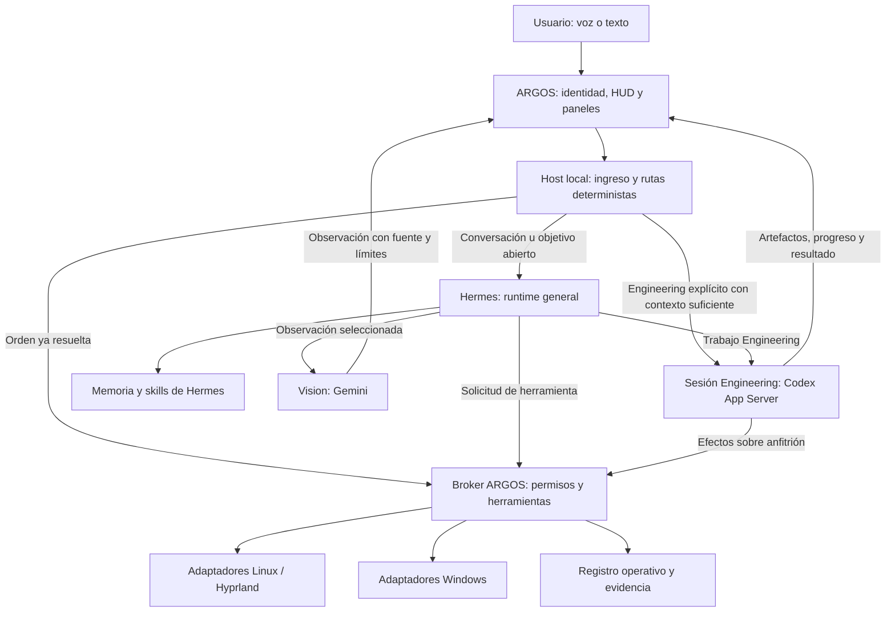

# ARGOS Next Generation: propuesta de arquitectura con Hermes

**Fecha:** 4 de noviembre de 2026. **Estado:** investigación y planificación; pendiente de validar mediante un piloto autorizado. **Esta propuesta no instala Hermes ni modifica el runtime de ARGOS.**

## Decisión resumida

**Recomiendo A: Hermes como runtime principal de conversación, memoria y coordinación general.** ARGOS conserva su identidad, la experiencia de escritorio y una capa local de herramientas, autorización y evidencia. Codex trabaja como especialista de Engineering mediante App Server. La propuesta utiliza primero las integraciones que Hermes ya tiene y migra por capacidades comprobadas.

El Core actual se descompone: conserva los adaptadores y las garantías de ejecución que aporten valor; su bucle de interpretación, su memoria conversacional activa y su orquestación general se retiran cuando Hermes alcance paridad. El objetivo final no contiene dos motores generales decidiendo sobre la misma petición.

Para el primer hito recomiendo **reutilizar Hermes Desktop/HUD y su SDK de plugins**, antes de construir un cliente Tauri completo. Su aplicación principal utiliza Electron/React; el instalador bootstrap utiliza Tauri. En el ARGOS Linux inspeccionado no hay una aplicación Tauri/React que podamos conservar como cliente ya funcional. Tauri 2 + React sigue siendo una alternativa de presentación, independiente del runtime, si el HUD existente no permite el diseño o no cumple el presupuesto de recursos. [Desktop](https://hermes-agent.nousresearch.com/docs/user-guide/desktop), [SDK](https://hermes-agent.nousresearch.com/docs/developer-guide/desktop-plugin-sdk), [código del cliente](https://github.com/NousResearch/hermes-agent/blob/0073fa98cfcf61c066a919df4b336924720f8463/apps/desktop/package.json).

**Condiciones para migrar:** buena conversación real con el proveedor elegido, permisos efectivos sin rutas de evasión, continuidad de tareas/contexto y consumo aceptable en el PC. La documentación respalda la viabilidad; todavía no demuestra esos resultados en nuestra instalación.

## Referencias de producto: los dos vídeos

Se revisaron fotogramas de ambos vídeos y se generó una transcripción local con el Whisper ya instalado. La transcripción automática ayuda a localizar contenidos; los nombres y las afirmaciones técnicas se contrastaron con fuentes oficiales.

| Referencia | Observado | Consecuencia para ARGOS |
|---|---|---|
| [Primer vídeo, 50 s](/home/tyrant/Descargas/74d9f1214ed04ac589b1adb873221cdf.mp4) | Presencia circular ROSE, conversación con ironía, actividad de investigación y un informe que ocupa la pantalla cuando se solicita. | Presencia pequeña por defecto; voz breve; ventanas de trabajo bajo demanda; informe y fuentes visibles. La estética del vídeo no acredita su implementación o fiabilidad. |
| [Segundo vídeo, 96 s](/home/tyrant/Descargas/b6296c237cd642f5a1353d13d688aff7.mp4) | Entorno, Hermes como harness, selección del modelo, identidad del usuario, memoria, skills, herramientas, canales/voz y personalización visual. Aproximadamente 18–29 s: Hermes; 43–48 s: memoria/Honcho; 69–80 s: interfaz. | Adoptar un harness existente y conectar piezas. Investigar antes de desarrollar equivalentes propios. Honcho y ElevenLabs son opciones del vídeo, no requisitos para ARGOS. |

Los catorce adjuntos de texto recibidos son idénticos: SHA-256 `6f6c0ca76c6854162f70f6ec1f83b6d742a20125bc692617fa73e73574890503`. Se tratan como una única petición.

## 1. Evaluación de Hermes Agent

### Identidad y alcance de la comprobación

El proyecto investigado es **[NousResearch/hermes-agent](https://github.com/NousResearch/hermes-agent)**, software de agentes con licencia MIT. No es el modelo Hermes ni otros proyectos homónimos. Se examinó una copia de solo investigación del commit `0073fa98cfcf61c066a919df4b336924720f8463`, de 4 de noviembre de 2026, y la documentación oficial de Nous Research. No se ejecutó su instalador ni se arrancó su agente.

Convención del documento:

- **Verificado en documentación/código:** existe una interfaz o mecanismo en la revisión inspeccionada.
- **Propuesto para ARGOS:** integración o decisión que todavía hay que construir.
- **Pendiente de prueba:** compatibilidad, rendimiento o calidad que exige ejecutar el piloto en el equipo objetivo.

### Capacidades reales y límites

| Área | Verificado en documentación/código | Límite o consecuencia para ARGOS |
|---|---|---|
| Runtime | `AIAgent`, descubrimiento/ejecución de herramientas y adaptadores de proveedor. | Hermes necesita inferencia configurada; no aporta inteligencia independiente del modelo. |
| Windows | Ejecución nativa en Windows 10/11; WSL2 es otra opción. El paquete MSIX exige Windows 11 22H2 o posterior. | No necesitamos imponer WSL. Su shell utiliza Git Bash; eso no sustituye las APIs nativas de Windows. |
| Linux | Instalación Linux/WSL2 soportada; se prueba especialmente Ubuntu/WSL2. | Hyprland/Arch exige comprobación propia. El soporte de CLI no garantiza todos los paquetes Desktop ni todas las herramientas. |
| Sesiones | Historial persistente, recuperación, sesiones y protocolos para clientes externos. | Distinguir reanudar una conversación, volver a conectar con un trabajo vivo y recuperar un proceso después de caer. |
| Skills | Documentos `SKILL.md`, descubrimiento progresivo y archivos de apoyo. | Una skill aporta instrucciones; no implementa un driver ni concede permisos. |
| Memoria | Notas/perfil acotados, búsqueda de sesiones y extensiones de memoria. | Es administrada por herramientas, no una memoria perfecta e ilimitada. |
| Trabajo en segundo plano | Delegación, sesiones activas y trabajos programados. | La recuperación de efectos interrumpidos requiere verificar el estado; nunca asumir que todo puede repetirse. |
| Herramientas externas | MCP, plugins, middleware y adaptadores. | La presencia de un servidor o una skill no prueba su disponibilidad en este PC. |
| Uso programático | ACP, gateway JSON-RPC y API HTTP con streaming. | Debemos fijar versión y comprobar capacidades; no tratar el JSON-RPC interno como un protocolo inmutable. |
| Voz | STT local opcional, proveedores TTS y detección local de invocación. | «Argos», español/inglés, eco e interrupciones necesitan pruebas reales. |
| Desktop | HUD, paneles, eventos y SDK de extensión. | El SDK no demuestra que permita sustituir cualquier parte del HUD por una esfera; ese punto requiere un spike de UI. |

Fuentes: [arquitectura](https://hermes-agent.nousresearch.com/docs/developer-guide/architecture), [plataformas](https://hermes-agent.nousresearch.com/docs/getting-started/platform-support), [Windows nativo](https://hermes-agent.nousresearch.com/docs/user-guide/windows-native), [sesiones](https://hermes-agent.nousresearch.com/docs/user-guide/sessions), [delegación](https://hermes-agent.nousresearch.com/docs/developer-guide/delegation-provider-plugin), [cron](https://hermes-agent.nousresearch.com/docs/user-guide/features/cron).

### Instalación y operación local

La ruta oficial proporciona instaladores POSIX y PowerShell, además de paquetes Desktop. La revisión inspeccionada gestiona dependencias mediante su propio gestor PM y Python 3.14; algunas funciones preparan dependencias opcionales bajo demanda. La instalación debe fijar una revisión/versión y revisar sus componentes, sin ejecutar un `curl | bash` directamente sobre el entorno estable de ARGOS. No se propone `pip install hermes-agent`: la matriz oficial no considera soportada esa distribución. [Instalación](https://hermes-agent.nousresearch.com/docs/getting-started/installation), [matriz de soporte](https://hermes-agent.nousresearch.com/docs/getting-started/platform-support), [dependencias declaradas](https://github.com/NousResearch/hermes-agent/blob/0073fa98cfcf61c066a919df4b336924720f8463/pyproject.toml).

No hay una cifra de RAM/CPU validada aquí. Con inferencia remota no necesita cargar un LLM conversacional en nuestra GPU. Python, Desktop, voz, navegador y extensiones sí consumen recursos; cada componente opcional debe medirse y activarse cuando corresponda.

### Interfaz de integración recomendada

Para un cliente ARGOS propio, usar el **gateway JSON-RPC** documentado: sesiones, envío de prompts, eventos, interrupción y solicitudes de aprobación. `client.capabilities` debe anunciar soporte de solicitudes del servidor; una aprobación es una solicitud con respuesta correlacionada, no un evento visual que podamos ignorar.

ACP resulta útil para clientes que ya hablen ese protocolo. La API HTTP sirve para consumidores compatibles con OpenAI y ofrece mecanismos propios de admisión/runs; una llamada a `/v1/chat/completions` no equivale por sí sola a un contrato completo de tareas y aprobaciones. Para el piloto, elegir una sola interfaz y su owner de sesiones. [Integración programática](https://hermes-agent.nousresearch.com/docs/developer-guide/programmatic-integration), [API Server](https://hermes-agent.nousresearch.com/docs/user-guide/features/api-server).

## 2. Decisión de arquitectura: comparación A/B/C

| Opción | Ventaja | Coste/riesgo | Decisión |
|---|---|---|---|
| **A. Hermes es el runtime principal** | Reutiliza memoria, skills, proveedores, sesiones y delegación. | Migración y endurecimiento de herramientas; posible pérdida de garantías si se activan defaults indiscriminadamente. | **Objetivo recomendado**, con migración gradual y gates. |
| **B. Hermes es un especialista del Core actual** | Permite experimentar con poco cambio inicial. | Dos planificadores y dos historiales podrían competir; mantiene buena parte del trabajo que queremos dejar de recrear. | Solo como experimento aislado y reversible; no como arquitectura final. |
| **C. Usar ideas y conservar nuestro runtime** | Control máximo y menor dependencia upstream. | Seguimos manteniendo memoria, skills, recuperación e integraciones generales. | Alternativa si el piloto A falla en requisitos concretos que no puedan resolverse razonablemente. |

Esta decisión es una inferencia técnica a partir de las capacidades verificadas, no una afirmación de que la migración ya funciona.

### Distribución propuesta de responsabilidades



**Hermes es dueño del ciclo de razonamiento general y del árbol de trabajo.** El Host conserva rutas deterministas e integra ciclos de vida; no añade un LLM de clasificación, un planificador alternativo o una segunda cola de objetivos. El Broker autoriza/ejecuta efectos y registra evidencia. Su concurrencia de operaciones y su ledger no constituyen otro agente.

Una sesión Engineering usa el runtime de Codex para su propio trabajo. Hermes mantiene la relación padre/hijo y el contexto seleccionado, sin ejecutar además un segundo bucle de herramientas sobre ese mismo turno. Para una orden Engineering ya inequívoca, el Host puede iniciar directamente esa sesión especializada y registrar la relación con la petición.

### Rutas concretas

| Petición | Recorrido propuesto |
|---|---|
| «Abre Firefox» | Resolución determinista existente → adaptador de aplicaciones. Cero inferencias si la acción queda resuelta. |
| «Corrige el importador» con proyecto y alcance conocidos | Sesión Codex por tarea → candidata/plan/pruebas → artefacto y resultado. |
| «Organiza estas carpetas» | Hermes → herramientas de inspección → propuesta concreta → operaciones autorizadas. |
| «Mira mi mesa» | Captura solicitada → Vision → observaciones. Sin transmitir vídeo continuamente. |
| «Enséñame el informe» | Mostrar artefacto ya existente; no volver a pedir al modelo que lo genere. |

Si faltan referentes, la ruta general resuelve la ambigüedad. Una coincidencia superficial con una palabra no convierte una pregunta o un ejemplo en autorización.

## 3. Estrategia de inteligencia y especialistas

### General: Hermes con inferencia gratuita, sujeta a evaluación

**Candidato inicial:** proveedor nativo Gemini de Hermes y `gemini-3.8-flash`, cuya ficha admite imágenes/herramientas y cuya tarifa consultada ofrece entrada/salida gratuitas en Free Tier. Es una propuesta de evaluación, no una selección ya aplicada ni una garantía de acceso de nuestra cuenta. Hay que comprobar cuota y condiciones efectivas en AI Studio. [Modelo](https://ai.google.dev/gemini-api/docs/models/gemini-3.8-flash), [tarifa](https://ai.google.dev/gemini-api/docs/pricing#gemini-3.8-flash).

La documentación de Hermes advierte expresamente que el nivel gratuito de Gemini puede resultar insuficiente para sesiones largas con varias llamadas de herramientas. Esta restricción cuenta tanto como la calidad. OpenRouter ofrece modelos gratuitos compatibles, pero sus límites y la variabilidad del modelo/proveedor lo convierten en alternativa de prueba, no en una promesa de servicio permanente. [Hermes + Gemini](https://hermes-agent.nousresearch.com/docs/guides/google-gemini), [límites gratuitos de OpenRouter](https://openrouter.ai/collections/free-models/).

Propuesta de selección:

1. Comparar conversación, tool calling, correcciones, ES/EN y latencia con la conversación actual de Codex como referencia.
2. Evaluar carga real de 30–60 minutos, no únicamente saludos aislados.
3. Rechazar cambios que recuperen las respuestas pobres o la espera que ya experimentamos con otros proveedores.
4. Si ningún gratuito cumple, mantener como opción explícita el perfil ligero de Codex cubierto por la suscripción existente, contabilizando su cuota. La arquitectura Hermes no depende de que Gemini gane la comparación.

No se habilitan facturación adicional ni fallbacks de pago automáticamente. General y Vision pueden compartir la cuota de un mismo proyecto Gemini; hay que presupuestar ambos. El tratamiento de datos del nivel gratuito también debe revisarse antes de enviar pantallas o contenido privado. Google documenta disponibilidad gratuita en regiones del EEE, pero la elegibilidad y cuota de la cuenta siguen siendo una comprobación pendiente. [Facturación](https://ai.google.dev/gemini-api/docs/billing), [condiciones](https://ai.google.dev/gemini-api/terms).

Si se utiliza Codex ligero como inferencia de General, debe conservarse el bucle de Hermes y sus herramientas de memoria. No activar globalmente App Server y suponer que ese General conserva las mismas herramientas. La elección de proveedor y la elección de runtime son dos decisiones distintas.

### Engineering: Codex mediante App Server existente en Hermes

**Hermes ya implementa un runtime opcional de Codex App Server**, con threads persistentes, eventos y proyección del resultado. No es necesario dar por hecho que hay que construir otro adaptador desde cero. Su transporte y sesión están presentes en `agent/transports/codex_app_server.py` y `codex_app_server_session.py`. [Runtime documentado](https://hermes-agent.nousresearch.com/docs/user-guide/features/codex-app-server-runtime), [cliente fuente fijado](https://github.com/NousResearch/hermes-agent/blob/0073fa98cfcf61c066a919df4b336924720f8463/agent/transports/codex_app_server.py), [sesión fuente](https://github.com/NousResearch/hermes-agent/blob/0073fa98cfcf61c066a919df4b336924720f8463/agent/transports/codex_app_server_session.py).

Hay que distinguir el proveedor `openai-codex` —acceso a inferencia— del runtime `codex_app_server`, que entrega a Codex el bucle de herramientas. Este último tiene herramientas nativas y restricciones diferentes: memoria, búsqueda de sesiones y delegación de Hermes no están expuestas como herramientas dentro de ese turno. La integración padre/general debe recuperar esos datos y entregar el subconjunto pertinente.

Propuesta para ARGOS:

- Un thread por tarea Engineering, ligado a proyecto, módulo, candidata y modelo/esfuerzo.
- Reutilizar el transporte nativo de Hermes si supera nuestras pruebas de afinidad, autorización, streaming y recuperación.
- Mantener `src/argos/codex.py` como referencia/fallback de migración, con un único transporte activo para cada tarea.
- Verificar la combinación concreta «General Gemini + hijo Engineering App Server»; que existan ambas piezas no acredita esa configuración completa.
- Revisar el ámbito de `model.openai_runtime`: se aplica en la resolución de proveedores elegibles. Usar una ruta/sesión soportada o un perfil Engineering aislado, en lugar de alternar un flag global mientras hay tareas vivas. Si hacen falta perfiles separados, el de Engineering conserva estado técnico de tarea/thread y recibe referencias del padre; no se convierte en otro escritor de preferencias o memoria personal. [Resolución de runtime](https://github.com/NousResearch/hermes-agent/blob/0073fa98cfcf61c066a919df4b336924720f8463/hermes_cli/runtime_provider.py).
- Trabajar dentro de una candidata con permisos acotados. Aplicar cambios al origen sigue siendo otra operación revisable.
- Separar configuración y credenciales de la integración de las personales del IDE. El runtime Hermes puede modificar un bloque de configuración de Codex e importar plugins: revisar ese comportamiento en el piloto y evitar la adopción indiscriminada de conectores.

App Server es el protocolo oficial para integrar clientes con conversaciones, aprobaciones y eventos; el acceso depende de la cuenta y del modelo. La disponibilidad en `model/list` no acredita por sí sola que una inferencia vaya a completarse. No se presupone uso ilimitado por disponer de Pro. [OpenAI Docs: App Server](https://developers.openai.com/codex/app-server), [uso con plan ChatGPT](https://developers.openai.com/siwc/token-sharing-open-source/codex-app-server).

### Vision: Gemini bajo demanda

Usar el soporte multimodal del proveedor y las capacidades de imagen existentes en Hermes. El código de `vision_analyze` admite adjuntar imágenes al modelo principal compatible o recurrir al proveedor auxiliar. Se propone una ruta explícita Gemini para capturas y cámara, configurada y limitada en cuota. La captura local y la selección de qué enviar pertenecen a ARGOS. [Implementación](https://github.com/NousResearch/hermes-agent/blob/0073fa98cfcf61c066a919df4b336924720f8463/tools/vision_tools.py).

La salida debe identificar imagen/frame, instante, objetos observados, incertidumbre y datos que faltan. Una imagen corriente no establece por sí sola medidas físicas precisas. Para CAD hacen falta escala/calibración o medidas confirmadas.

### Evitar cadenas innecesarias

No añadir un Persona Agent o un modelo que vuelva a redactar todas las respuestas. Conversación simple: un turno generativo. Herramientas: las rondas necesarias para su ejecución, medidas y limitadas. Resultado Codex: resumen/artefactos del propio especialista. Acción determinista resuelta: cero inferencias.

Desactivar inicialmente revisiones autónomas de skills, heartbeats y clasificadores de riesgo por LLM que generen llamadas invisibles. `approvals.mode: smart` usa inferencia auxiliar; no elegirlo suponiendo que es una comprobación local gratuita. La autorización efectiva de los efectos del anfitrión sigue siendo determinista. [Seguridad Hermes](https://hermes-agent.nousresearch.com/docs/user-guide/security).

## 4. Memoria: una autoridad por dato

**Hermes será el único sistema activo de memoria cognitiva:** conversación, preferencias, decisiones y recuperación de conocimiento. Se retira la recuperación conversacional paralela del Core actual al cambiar al nuevo runtime.

Eso no convierte un resumen editable por el modelo en autoridad sobre rutas, permisos o resultados. El registro operativo del Broker conserva identificadores, asociaciones de máquina/ruta y evidencia verificada. Hermes consulta esos hechos mediante herramientas/recursos y guarda referencias; no mantiene una segunda copia autoritativa del mismo campo.

| Información | Autoridad propuesta | Acceso de especialistas |
|---|---|---|
| Identidad/estilo ARGOS | Configuración versionada de `SOUL.md` y contrato de salida | Se incluye una vez al iniciar la sesión pertinente. |
| Preferencias y decisiones duraderas | Memoria nativa de Hermes | Recuperación pertinente, no exportación del historial completo. |
| Conversaciones y continuidad | Sesiones/almacenamiento de Hermes | Referencias y extractos seleccionados. |
| Procedimientos aprendidos | Biblioteca de skills de Hermes, con revisión de cambios | Carga progresiva de la skill pertinente. |
| Proyecto, alias y raíz por máquina | Registro operativo validado, expuesto a Hermes | `project_id` y consulta de contexto/evidencia. Las notas no pueden cambiar la raíz por su cuenta. |
| Aplicaciones/dispositivos disponibles | Observación del adaptador local, con fecha | Consulta; no tratar una nota antigua como disponibilidad actual. |
| Trabajo vivo | Árbol y sesiones de ejecución de Hermes/especialista | Estados y referencias a artefactos. El ledger local es una proyección verificable. |
| Aprobaciones y efectos realizados | Broker y backend de ejecución responsable | Referencia a evidencia; nunca una frase del modelo como prueba. |

Esto son almacenes de responsabilidades distintas, no dos motores de memoria compitiendo por recordar el proyecto. Una misma raíz no se edita simultáneamente en `MEMORY.md` y en SQLite. La selección de proyecto tampoco depende de la última palabra que pronuncie un especialista.

La memoria nativa usa `MEMORY.md` y `USER.md` acotados, junto con el historial/búsqueda de sesiones; no cabe volcar ahí todos los repositorios o informes. Las actualizaciones deben existir como escrituras reales. El snapshot de memoria en el prompt tiene reglas de actualización propias. [Memoria persistente](https://hermes-agent.nousresearch.com/docs/user-guide/features/memory).

**Honcho no es obligatorio.** Los proveedores externos son extensiones adicionales, y la memoria incorporada sigue activa junto a ellos. Para nuestro requisito local, comenzar con memoria nativa y búsqueda local. Un proveedor externo solo se incorporaría si aporta una necesidad demostrada, con despliegue local o una decisión explícita sobre su servicio/coste. No instalar Honcho por aparecer en el vídeo. [Proveedores de memoria](https://hermes-agent.nousresearch.com/docs/user-guide/features/memory-providers), [interfaz de extensión](https://hermes-agent.nousresearch.com/docs/developer-guide/memory-provider-plugin).

### Handoff limitado entre Hermes y Engineering

Contrato conceptual, todavía no implementado:

```text
task_id + parent_session_id + specialist_session_id
project_id + machine_id + module_scope
objective + confirmed_constraints
source_revision + candidate_ref
selected_evidence_refs + required_skill_refs
authorization_ref + allowed_host_capabilities
expected_outputs + verification_requirements
```

El especialista recupera información mediante referencias autorizadas. Devuelve resumen, artefactos, comprobaciones, límites y estado. El padre guarda decisiones útiles y referencias al resultado; no vuelve a ingerir cada log y archivo de la tarea.

## 5. Skills y herramientas reales

Usar el formato real de Hermes/Agent Skills: carpeta con `SKILL.md`, metadatos de nombre/descripción y apoyos como `references/`, `scripts/` y `assets/`. La carga progresiva evita meter todas las instrucciones en cada turno. Los scripts incluidos no son autorización para ejecutarlos. [Skills](https://hermes-agent.nousresearch.com/docs/user-guide/features/skills).

| Skill lógica propuesta | Herramientas que necesita | Estado ARGOS actual |
|---|---|---|
| `computer.control` | Aplicaciones, ventanas, procesos y entrada, según plataforma | Adaptadores Linux parciales reutilizables; Windows pendiente. |
| `project.development` | Registro/contexto, candidata, App Server, pruebas y revisión | Flujo Linux existente útil como referencia de garantías. |
| `browser.automation` | Navegación/DOM/capturas y permisos por origen | Integración Firefox limitada; Hermes ofrece otras bases de navegador. |
| `communication.discord` | Conector con ámbitos de lectura/escritura separados | No conectado al ARGOS actual. Su incorporación requiere petición explícita. |
| `vision.workspace` | Captura seleccionada + inferencia visual | Propuesto. |
| `cad.generate` | Adaptador CAD, parámetros, exportación y validación | Propuesto; el inspector STL actual no genera CAD. |
| `printer.bambulab` | Slicer, artefacto y adaptador de impresora | Propuesto; el inspector G-code actual no controla una A1. |

Las denominaciones son un catálogo de capacidades deseadas, no nombres de herramientas ya implementadas. Skills reutilizables pueden dividirse para que cada una tenga un objetivo claro.

**Descubrimiento:** catálogo de herramientas → requisitos de plataforma → estado observado → esquema exacto. Las herramientas ARGOS se publicarán mediante MCP o un plugin Hermes que llame al Broker. Hermes ya ofrece registro/extensión; no diseñar otro protocolo de skills. Los middleware permiten envolver ejecución y observar resultados, pero no sustituyen aislamiento de procesos ni la autorización del Broker. [MCP](https://hermes-agent.nousresearch.com/docs/user-guide/features/mcp), [middleware](https://hermes-agent.nousresearch.com/docs/developer-guide/middleware), [registro de herramientas](https://github.com/NousResearch/hermes-agent/blob/0073fa98cfcf61c066a919df4b336924720f8463/tools/registry.py).

Las skills aprendidas/modificadas deben ser versionadas y revisables. Hermes tiene un mecanismo de aprobación de escrituras de skills; se propone activarlo al principio para no convertir aprendizaje en cambios silenciosos de comportamiento.

## 6. Estrategia multiplataforma

La identidad de una tarea utiliza `machine_id`, `project_id` y un alcance relativo; la raíz concreta se resuelve en el adaptador. No copiar una ruta POSIX como si fuese válida en Windows ni asumir que un PID o identificador de ventana es portable.

| Familia | Windows 11 nativo | Linux / Hyprland |
|---|---|---|
| Aplicaciones/ventanas | Shell/identidades de aplicación y UI Automation | `.desktop`, lanzamiento y Hyprland IPC |
| Archivos/Git/procesos | APIs de Windows, argv/cwd y Git instalado | APIs POSIX, argv/cwd y Git instalado |
| Navegador | Automatización local soportada por ese navegador | La misma semántica; backend local compatible |
| Captura/pantallas | API de captura y consentimiento aplicables | Portal/PipeWire o mecanismo específico del compositor |
| Cámara | Backend local compatible con Windows | Backend local compatible con V4L2/PipeWire |
| Entrada | Automatización por APIs de accesibilidad/input | AT-SPI y mecanismos del compositor; disponibilidad comprobada |
| Instalación | Gestor de paquetes/instalador revisado y verificado | Gestor de paquetes de la distribución; acción concreta revisada |
| CAD y dispositivos | Adaptador presente en esa máquina | Adaptador presente en esa máquina; no emular soporte inexistente |

Son decisiones de diseño de ARGOS, no garantías de equivalencia entre todos esos backends.

### Wayland y Hyprland

La documentación de Hermes describe `computer_use` mediante `cua-driver`, con accesibilidad y dispatch diferenciados por OS. También menciona requisitos y una ruta de captura en Wayland que debe verificarse en la sesión real. Conservar primero nuestras rutas deterministas de Hyprland; probar el driver para las tareas que necesiten control de interfaz. [Computer Use](https://hermes-agent.nousresearch.com/docs/user-guide/features/computer-use).

Un portal de captura no implica permiso general para inyectar teclado/ratón. El portal Hyprland documenta funciones como ScreenCast y atajos globales; el control de entrada necesita su comprobación propia. En Wayland el compositor manda sobre la colocación de ventanas: el HUD no puede asumir `setPosition` como en Windows. [Portal Hyprland](https://wiki.hypr.land/hypr-ecosystem/user/xdg-desktop-portal-hyprland/), [HUD de Hermes](https://hermes-agent.nousresearch.com/docs/user-guide/desktop#linux--wayland).

WSL2 puede alojar un runtime, pero no convierte herramientas Linux en control nativo del escritorio Windows. Para controlar el host Windows, preferir Hermes y adaptadores nativos en la sesión interactiva de Windows. Si se utiliza WSL, se necesita un puente Windows explícito y autenticado.

### Navegador habitual y navegador de automatización

Hermes ya dispone de automatización local de Chromium/CDP y conexión con navegadores compatibles. Eso no sustituye automáticamente nuestra extensión Firefox ni acredita control de la sesión normal del usuario. Su `browser_exec` ejecuta Python y exige acceso a terminal: habilitarlo sin restricciones abriría un camino alternativo a la política del Broker. Evaluar un backend confinado o herramientas DOM tipadas del Broker; conservar Firefox para el caso que ya funciona mientras no haya sustituto probado. [Browser](https://hermes-agent.nousresearch.com/docs/user-guide/features/browser).

## 7. Interfaz de ARGOS

### Decisión inicial y comparación con Tauri

| Opción | Qué aprovechamos | Qué falta demostrar |
|---|---|---|
| **Hermes Desktop/HUD + SDK** | Sesiones, aprobaciones, artefactos y componentes React ya integrados; soporte explícito del HUD en Hyprland. | Personalización suficiente para la presencia ARGOS, consumo y distribución Linux. |
| **Tauri 2 + React propio** | Control del contenedor y de la experiencia visual; integración por el gateway. | Implementar cliente, reconexión, aprobaciones y empaquetado; validar WebKitGTK/Wayland. |
| Fork completo de Desktop/runtime | Libertad total. | Coste de mantener un producto paralelo; no es la primera opción. |

**Para M1: probar Desktop/HUD y SDK.** El SDK permite paneles, páginas, temas y acceso al estado real sin parchear los internos. La superficie exacta necesaria para una esfera independiente es una prueba de viabilidad, no una capacidad que demos por hecha. Si no alcanza, construir un cliente Tauri estrecho sobre el mismo gateway, conservando Hermes como runtime. [SDK Desktop](https://hermes-agent.nousresearch.com/docs/developer-guide/desktop-plugin-sdk), [Tauri: ventanas](https://v2.tauri.app/learn/window-customization/).

Tauri no implica cero GPU ni compatibilidad visual automática. En Linux usa WebKitGTK y su documentación recoge problemas gráficos de algunas combinaciones, especialmente NVIDIA. Su elección se decide con medidas y pruebas del PC, no por una cifra genérica de RAM. [Diagnóstico gráfico de Tauri](https://v2.tauri.app/develop/debug/linux-graphics/).

### Experiencia que debe entregar

- Presencia flotante pequeña, oscura, plana y discreta; sin dashboard permanente.
- Estados observables: espera, escucha, captura, inferencia, herramienta activa, pregunta, aprobación, error y desconexión.
- Reacción de voz basada en audio realmente reproducido. La animación no inventa progreso ni actividad del especialista.
- Paneles contextuales de proyecto, Engineering, artefactos y fuentes. Informes detallados en pantalla, con resumen hablado del mismo agente.
- Preguntas/aprobaciones vinculadas a la operación exacta; una ventana que se cierra no debe aprobar nada.
- Especialistas visibles con tarea, proyecto, estado y resultado. Un nombre «Design3D» no se presenta como un CAD conectado.
- Reconexión al gateway y trabajo que continúa al cerrar una superficie de UI, bajo un owner de runtime independiente.

La identidad ARGOS vive en `SOUL.md`/configuración versionada y en el contrato de salida. Se conserva el estilo serio, conciso e irónico cuando procede, sin añadir un modelo de personalidad.

### Voz local y presencia continua

Evaluar primero la infraestructura de voz de Hermes. Ya ofrece STT local y motores de invocación, por lo que no conviene mantener simultáneamente dos micrófonos, dos VAD y dos colas TTS. openWakeWord requiere un modelo adecuado para una palabra personalizada; sherpa ofrece detección por frase con sus propias restricciones. «Argos» no queda resuelto por cambiar el nombre en la interfaz. [Wake Word](https://hermes-agent.nousresearch.com/docs/user-guide/features/wake-word), [Voice Mode](https://hermes-agent.nousresearch.com/docs/user-guide/features/voice-mode).

Whisper/Pocket TTS, las selecciones SteelSeries y las pruebas de interrupción actuales son reutilizables como adaptador o referencia de aceptación. La decisión será un solo propietario de captura y reproducción. ElevenLabs no es requisito y no se propone añadir su suscripción.

## 8. Migración del ARGOS actual

| Componente actual | Destino | Trabajo concreto / condición de retirada |
|---|---|---|
| `core.py`: intérprete general y coordinación | **Reemplazar** por Hermes | Retirar el bucle duplicado al pasar las pruebas de paridad. Mantener solo Host/Broker con responsabilidades mecánicas. |
| `router.py`: órdenes deterministas | **Reutilizar/adaptar** | Conservar rutas conservadoras de coste cero. Las intenciones abiertas pasan al runtime Hermes. |
| `agents.py` y contratos | **Adaptar** | Identidad a SOUL/configuración; roles a sesiones/skills y catálogo efectivo. Retirar duplicados de instrucciones. |
| `store.py`: mensajes/conversaciones | **Migrar y archivar** | Importación verificable al contexto/historial de Hermes; el histórico anterior queda de solo lectura. No reproducir solicitudes viejas. |
| `store.py`: registro operativo/proyectos | **Reutilizar/adaptar** | IDs, raíces por máquina, alias, evidencia y auditoría. Sin otro recuperador semántico de memoria. |
| `projects.py` | **Adaptar** | Exponer herramientas de contexto/inspección al runtime único. Evitar resúmenes activos divergentes entre sistemas. |
| `codex.py` | **Evaluar reemplazo** | Preferir transporte nativo de Hermes si mantiene afinidad y permisos. Conservar pruebas/adapter hasta demostrarlo. Un transporte activo por tarea. |
| `policy.py`, revisión y autorizaciones | **Reutilizar como contrato de host** | Integrar preguntas de Hermes y decisiones del Broker; no sustituir por un clasificador de riesgo por LLM. |
| `development.py` / `development_workspace.py` | **Reutilizar garantías; adaptar ejecución** | Candidatas, alcance por módulo, hashes y pruebas. Sustituir su planificación duplicada por la del runtime elegido. |
| `filesystem.py`, `linux_tools.py`, `host.py` | **Reutilizar en adaptador Linux** | Separar interfaces de OS y añadir implementación Windows. |
| `firefox.py`, `media.py` y extensión | **Conservar hasta sustitución comprobada** | Mantener el caso YouTube/Firefox y controles actuales sin prometer que el browser Hermes lo reemplace todo. |
| `speech.py`, `voice.py`, `wake.py`, `echo.py` | **Comparar/adaptar** | Unificar con la voz Hermes; conservar pruebas y mejoras que superen al sustituto. |
| `transport.py` y `server.py` | **Adaptar** | El socket POSIX queda como adaptador interno cuando aporte valor; el frontend utiliza el protocolo elegido de Hermes. Windows requiere transporte apropiado. |
| `console.py`, `monitor.py`, `panels.py` | **Sustituir presentación progresivamente** | HUD/paneles conectados a eventos reales. Consola diagnóstica como fallback durante el piloto. |
| `providers.py`, `nvidia.py`, enrutamiento general por proveedor | **Retirar tras paridad** | Hermes gestiona proveedores. No mantener dos pilas de inferencia generales activas. |
| Tests y arneses de validación | **Reutilizar/ampliar** | Convertir garantías existentes en pruebas de aceptación del nuevo sistema. |

El registro de validación actual documenta 349 tests y dos recorridos con modelos reales, sobre fixtures. Sirve como baseline funcional; no acredita integración con Hermes ni funcionamiento nativo en Windows. No se repitieron esas pruebas en esta investigación documental.

### Secuencia de cambio

1. Checkpoint recuperable del estado actual, exportación de datos y baseline de voz/tareas.
2. Piloto Hermes con perfil/directorio aislado y datos de prueba; no dos escritores sobre el mismo Hermes home.
3. Adaptador de herramientas y pruebas de permisos antes de permitir efectos sobre el PC real.
4. Comparación de voz, conversación, memoria, especialistas y recursos.
5. Corte por dominios: cada sesión/ruta pertenece al Core antiguo o a Hermes; nunca enviar la misma petición con efectos a ambos.
6. Migración comprobable e idempotente de datos seleccionados. Histórico viejo de solo lectura y rollback del corte, sin replay de tareas.
7. Retirar lo sustituido cuando haya paridad documentada. Rollback de despliegue no implica revertir indiscriminadamente cambios hechos en proyectos del usuario.

## 9. Primer hito: una vertical funcional antes de migrar todo

**M1 — ARGOS sobre Hermes, con un proyecto y un especialista reales.** Las tareas siguientes son un plan de implementación futura, no trabajo autorizado por esta petición de investigación.

### Recorrido de demostración

1. Abrir una presencia HUD ligada al gateway real en Linux/Hyprland y realizar el equivalente en Windows 11.
2. «Argos, abre Firefox» → efecto observado sin inferencia cuando se resuelve localmente.
3. «Trabajemos con Some and CO2» → proyecto/alias resueltos; selección y hechos recuperables después de reiniciar.
4. «Revisa el importador y prepara esta mejora concreta» → Engineering App Server ligado a tarea, proyecto y módulo, con una candidata de prueba.
5. Mostrar el plan/aprobación y permitir seguir conversando mientras trabaja. Cambiar de proyecto no cambia el de la tarea.
6. Mostrar progreso, diff, comprobaciones y resultado; voz breve. Cerrar y reabrir el HUD conserva el acceso al trabajo.
7. Rechazar cambios fuera del alcance y reintentos ambiguos; los fallos se presentan sin éxito inventado.

Para pruebas con efectos utilizar primero una fixture/checkout desechable. En `some-and-co2` real comenzar por lectura y registro. Una mejora de producto necesita un objetivo concreto y su plan revisable.

### Orden de trabajo y puertas de aceptación

| Bloque | Entrega | Criterio de salida |
|---|---|---|
| M1.0: compatibilidad | Revisión fijada, mapa de protocolos/configuración, Linux y Windows. | Inicia sin proveedor de pago nuevo; se identifican claramente dependencias y funciones no disponibles. |
| M1.1: host de herramientas | Conjunto mínimo de herramientas ARGOS expuesto a Hermes. | Efectos del host pasan por Broker; shell/browser/scripts no abren rutas alternativas; pruebas negativas reales. |
| M1.2: memoria y proyecto | Importación pequeña, selección y referencias. | Alias/ruta estables; otra sesión/proyecto no filtra datos ni reasigna tareas. |
| M1.3: Engineering | Ruta nativa App Server y eventos de tarea. | Afinidad tras pregunta/aprobación/reinicio; candidata y pruebas verificadas; origen intacto hasta aplicar. |
| M1.4: HUD y voz | Presencia, panel de tarea y preguntas reales. | «Argos» sin Espacio, ES/EN, interrupción, fin audible y cierre/reconexión en ambos OS. |
| M1.5: evaluación | Matriz de casos y métricas. | Decisión de corte respaldada por evidencia y comparación con el baseline. |

Batería mínima propuesta: 20 situaciones conversacionales ES/EN, 10 operaciones observables, 5 recuperaciones/reconexiones y 5 denegaciones de permisos. Son objetivos de prueba, no resultados obtenidos.

No aceptar un flujo en el que la UI muestre «terminado» solo porque el modelo escribió esa palabra. No aceptar que un 429 repita automáticamente una acción cuyo efecto no se conoce.

## 10. Los tres hitos siguientes

| Hito | Función entregable | Condición para avanzar |
|---|---|---|
| **M2: navegador y trabajo cotidiano** | Browser local con orígenes/acciones definidos; navegación, interacción y evidencias. Aplicaciones/ventanas equivalentes por OS. | Selección real del elemento, manejo de sesión habitual opt-in, ausencia de foco inesperado y fallos de permisos transparentes. Firefox actual solo se retira con paridad. |
| **M3: Vision y memoria aplicada al entorno** | Capturas/frame de cámara solicitados; observaciones estructuradas y panel visual; decisiones útiles guardadas por Hermes. | Nada de inferencia continua por defecto; fuente/fecha/uncertumbre visibles; medidas pedidas o calibradas antes de utilizarlas en diseño. |
| **M4: CAD, slicer y dispositivos** | Generar un diseño paramétrico sencillo, previsualizar, exportar, laminar y preparar una orden Bambu A1 revisable. Después, ejecución y monitorización del dispositivo. | Aprobación del modelo y otra autorización ligada al artefacto/configuración de impresión; adaptador real y estado verificado. |

### Comprobación del flujo físico futuro

```text
Petición → frame seleccionado → observaciones/medidas confirmadas
→ tarea Codex + skill CAD → parámetros y archivo fuente
→ preview y validación → aprobación de diseño
→ slicer con perfil/material → artefacto de impresión con hash
→ autorización de ejecución ligada a A1/configuración
→ envío por adaptador local → estado observado y monitorización
```

Todas las etapas pasan referencias a artefactos y evidencia. No hay que volver a enviar la conversación entera a Vision, Codex y Hermes.

Fusion no debe considerarse un ejecutable nativo Linux: el adaptador se ejecutará en una plataforma admitida por Autodesk, o habrá que evaluar otro CAD para el backend Linux. Elegir motor CAD es una decisión posterior; no forzar técnicas de automatización Windows sobre Wayland. [Soporte Autodesk](https://www.autodesk.com/support/technical/article/caas/sfdcarticles/sfdcarticles/Is-there-any-way-to-install-Fusion-360-in-Linux.html).

Bambu Studio documenta uso por línea de comandos para archivos/perfiles y laminado. Eso aporta una base para el slicer, no prueba una API universal de control o monitorización de la A1. El transporte al dispositivo y sus límites/autorización necesitan investigación específica antes de actuar físicamente. [CLI oficial de Bambu Studio](https://github.com/bambulab/BambuStudio/wiki/Command-Line-Usage).

La autoactualización reutiliza el mismo patrón de artefactos: candidata → comprobaciones → revisión → autorización exacta → activación → comprobación de salud → rollback de versión. La creación/mejora de skills de Hermes no equivale a instalar una versión ejecutable de ARGOS.

## 11. Seguridad, operación continua y rendimiento

### Decisiones propuestas para el piloto

- Perfil General mínimo: memoria/skills de lectura y herramientas autorizadas; desactivar inicialmente terminal local amplio, ejecución arbitraria de código, instalación perezosa y conectores no solicitados.
- `manual` y denegación en contextos sin usuario para las aprobaciones Hermes pertinentes; nunca `off`/YOLO como atajo. La política del Broker se aplica aunque una capa superior no pregunte.
- No usar un detector de comandos peligrosos como única barrera de archivos, red o impresora. Skills, MCP, browser y plugins tienen que entrar en el mapa de permisos.
- Engineering puede usar herramientas nativas de Codex **dentro de su candidata confinada**. Efectos sobre el host/origen/dispositivo se canalizan por Broker y autorización específica. Ese confinamiento se prueba con operaciones negativas por plataforma.
- Linux: conservar el aislamiento de comprobaciones existente cuando sea apropiado. Windows: verificar el sandbox nativo soportado por la versión de Codex; un Job Object solo limita ciclo de vida/recursos, no es por sí solo una sandbox de archivos/red. [OpenAI Docs: Windows sandbox](https://developers.openai.com/codex/windows).
- Credenciales en el almacén local apropiado con permisos del OS; nunca en memoria conversacional, skills, resultados o capturas enviadas por defecto. El runtime necesita acceso a sus proveedores, pero el modelo y herramientas de host no reciben secretos crudos.
- IPC local autenticado o canal privado. Nada de listener general abierto a la red como requisito del escritorio. Preguntas correlacionadas, expiración y cancelación explícitas.
- Un owner de sesiones por Hermes home y un ledger de efectos con IDs estables. Un efecto desconocido tras caída requiere comprobación; no se promete exactly-once por añadir una clave de solicitud.

Son controles que ARGOS debe configurar/verificar. La documentación de seguridad de Hermes describe patrones de comandos, modos de aprobación, aislamiento y controles MCP; no demuestra por sí sola que toda combinación de herramientas cumpla nuestra política. [Seguridad](https://hermes-agent.nousresearch.com/docs/user-guide/security).

### Riesgos de integración que deben medirse o resolverse

| Riesgo | Comprobación / respuesta propuesta |
|---|---|
| Browser Python/terminal evita el Broker | Backend confinado o API de acciones tipadas; no activar acceso amplio para conseguir clicks. |
| App Server importa plugins/configuración personal | Perfil/configuración revisados; lista explícita de conectores. |
| Modelo gratuito consume cuota en rondas/revisión de skills | Medir llamadas totales y turnos útiles; desactivar automatismos no necesarios. |
| Memoria dice haber guardado algo sin escritura | Comprobar herramienta, persistencia y lectura tras reinicio. |
| SDK Desktop no permite toda la presencia circular | Spike pequeño; Tauri como reemplazo del cliente, sin rehacer Hermes. |
| Native Wayland impide un gesto, colocación o captura | Adaptador Hyprland y fallback visible; no declarar paridad por haber compilado Linux. |
| Actualización upstream cambia el protocolo | Pin de versiones, pruebas contractuales y revisión antes de actualizar. |
| Error/cancelación mezcla voz antigua con intención nueva | Preservar pruebas de generaciones, colas e interrupción del ARGOS actual. |

### Presupuesto de rendimiento propuesto

Medir por separado el proceso Hermes, HUD, STT/TTS, App Server, navegador y cualquier sidecar. Informar también del total, no esconder consumo excluyendo el proceso de voz.

- En reposo: ninguna inferencia remota periódica ni LLM local obligatorio; ningún proceso de Vision/CAD/navegador abierto sin necesidad.
- Sin micrófono: objetivo inicial de CPU media inferior al 0,5 % de un núcleo durante 10 minutos; con invocación activa, presupuesto inicial inferior al 2 %. Son criterios propuestos que pueden exigir ajustar motor/hardware, no mediciones actuales.
- Medir RAM residente y pico en espera, conversación, Engineering y modo juego. Adoptar el presupuesto de RAM definitivo después de comparar los clientes; no asignar a Hermes una cifra inventada.
- GPU: sin inferencia conversacional/visual local obligatoria. El renderizado del HUD puede usar GPU gráfica; pausar animaciones cuando está inactivo/oculto y limitar frecuencia al hablar.
- Dos tareas de trabajo simultáneas como punto de partida; límites por proyecto y por capacidad. Modo juego reduce o pausa trabajo pesado y conserva resultados.
- Latencia: desde fin de voz a primer sonido y desde solicitud a efecto verificado; p50/p95, arranque frío y sesión caliente. No comparar solo tiempo del modelo.

El runtime debe poder vivir sin la ventana. En Linux se evaluará servicio de usuario; en Windows, inicio en la sesión interactiva del usuario, no un servicio de Session 0 que luego prometa acceso al escritorio. No activar autoinicio durante esta fase de investigación.

## 12. Evidencia y alcance de lo realizado

### Código de Hermes inspeccionado

Revisión fijada: [0073fa98cfcf61c066a919df4b336924720f8463](https://github.com/NousResearch/hermes-agent/tree/0073fa98cfcf61c066a919df4b336924720f8463).

| Archivo o área | Uso en la investigación |
|---|---|
| `run_agent.py`, `agent/`, `model_tools.py`, `tools/registry.py` | Separar loop, proveedores, registro y ejecución. |
| `tui_gateway/`, `gateway/platforms/api_server.py`, `acp_adapter/` y docs de integración | Protocolos, sesiones, streaming y preguntas/aprobaciones. |
| `agent/transports/codex_app_server*.py` | Existencia del transporte nativo, afinidad de thread y recuperación. |
| `agent/memory_provider.py`, documentación de memoria/skills | Interfaz de memoria y diferencia entre instrucciones, herramientas y conocimiento. |
| `tools/vision_tools.py`, browser y documentación Computer Use | Modalidades y fronteras de las herramientas. |
| `apps/desktop/package.json`, docs Desktop/SDK | Electron/React, HUD, extensibilidad y contraste con Tauri. |
| `pyproject.toml`, instalación y Windows nativo | Dependencias y compatibilidad declarada. |

### ARGOS inspeccionado

`README.md`, `docs/architecture.md`, contratos, Core/Store/Projects, adaptadores, App Server, desarrollo aislado, voz, IPC y los últimos informes de validación. Se respetaron los cambios locales previos. `docs/redisign.md` estaba vacío al iniciar esta investigación.

**Cambios de esta entrega:** únicamente este documento de propuesta. Se consultaron fuentes públicas, se extrajeron referencias de los vídeos y se inspeccionó código en una copia temporal. No se instaló/ejecutó Hermes, no se migró la memoria, no se cambiaron proveedores, no se modificó el ARGOS operativo y no se efectuaron pruebas de Windows, cuotas o consumo.

**Siguiente acción recomendada:** autorizar e implementar M1.0–M1.1 como spike acotado sobre un perfil aislado; decidir el corte únicamente con sus resultados. El diseño A es la recomendación actual. Los puntos de SDK/HUD, seguridad de herramientas y calidad/cuota gratuita son puertas de aceptación explícitas, no detalles aplazados hasta después de reemplazar el sistema.
