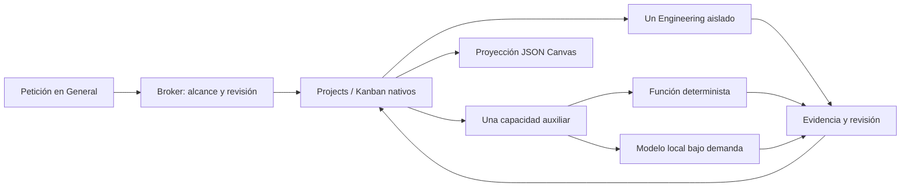

# Adaptive Agent Network — implementación y pruebas

**Red experimental funcional, sin promoción a la instalación habitual.** Se ejecutaron un modelo local, General, Engineering aislado y OpenClaw real con la suscripción existente. Hermes permanece operativo por la evidencia actual; OpenClaw sigue siendo candidato a sustituirlo, pero no ha alcanzado paridad A/B. [Evidencia saneada](adaptive-network-2026-11-06.json), [workflow real en JSON Canvas](adaptive-workflow-2026-11-06.canvas), [preparación para casa](../adaptive/SETUP.md), [catálogo](../adaptive/CATALOGUE.md).

Implementación: commit `43f3813` (`feat: add bounded adaptive capabilities on native Hermes tasks`). Este informe y el relevo se guardan en el commit documental siguiente.

## Base e integración

Se parte de A `8958bcf`, B `c7e0ca9` y el plan `826fb2c`. El pin Hermes `0073fa98…` y el hash de la reparación de persistencia de A pasan el verificador existente. Se reutilizan el lanzador de Codex, la política de filesystem/red, la autorización de carpetas y las revisiones de B. No se modifica `src/argos`, la identidad, voz, navegador, aplicaciones ni mantenimiento; no se activan operaciones de C/D.

La herramienta MCP `adaptive` usa el Broker y el adaptador Projects existentes. Solo se anuncia si Projects y `adaptive_enabled` están activados. El laboratorio tiene bases/configuración propias; la instalación operativa conserva B y no recibe este despliegue.

Cuatro implementaciones acotadas: normalizar listas, extraer elementos con un modelo local, inventariar metadatos del directorio autorizado y contar extensiones de un inventario previo. La selección `items + lines/prose` es determinista. El registro describe permisos, recursos, disponibilidad, calidad, coste, paralelismo y ciclo de vida; descubrirlo no carga modelos. No hay llamada adicional de IA para routing o acknowledgements.

Proyectos, tareas, dependencias, intentos y resultados permanecen en **Projects/Kanban nativos**. El adaptador usa el hook `spawn_fn` del dispatcher para ejecutar una función controlada; no incorpora otro scheduler, base de tareas ni conversaciones entre especialistas. Los auxiliares ejecutan código confiable registrado; el modelo solo recibe texto acotado y no tiene herramientas. El estado se consulta por proyecto, con máximo 200 tareas y señal de truncamiento; Canvas rechaza una proyección incompleta.

Las mutaciones exigen revisión del proyecto; cancelación exige además revisión de tarea. Los workflows validan hasta ocho nodos antes de crear tareas y reutilizan claves idempotentes. Un intento interrumpido se aparca para inspección, sin repetir el efecto. Schema correcto no implica semántica correcta: los resultados del modelo quedan en `review`.

## E1 — inteligencia local

Se reutilizó Ollama **0.40.7** con hogar, endpoint y almacén separados. Única descarga de modelo: **Qwen3 0.6B**, digest fijado en el manifiesto, GGUF Q4_K_M, 523 MB. CPU, dos hilos, contexto 2048, máximo 512 tokens, un modelo y una inferencia simultánea. No se instaló llama.cpp ni otra colección de modelos.

Fixture: devolver `STL, OBJ, 3MF` en JSON, mismo contenido comparado con General.

| Medida real | Resultado |
|---|---|
| Transformación determinista | 0,000661 s, correcta |
| Modelo frío | 2,315 s; carga 1,309 s, evaluación prompt 0,554 s, generación 0,448 s |
| Modelo caliente, dos muestras | 0,536 s / 0,575 s; ambas correctas |
| Modelo residente según Ollama | 783.663.757 bytes; VRAM 0. No es el RSS total del sistema |
| Descarga explícita | 0,010 s; lista de modelos cargados vacía |
| Caducidad inactiva de 30 s | Observada a los 30,044 s; lista vacía |
| Servidor sin modelo, RSS al cierre | 40.685.568 bytes |
| General/Hermes, mismo JSON, segunda prueba | 3,385 s de turno; arranque separado 1,277 s |

La lista explícita no gana nada usando IA: código resulta correcto y más rápido. La extracción local de una frase también produjo los tres elementos y quedó en revisión; prueba el contrato, no una evaluación amplia de precisión. No se deduce p95 ni superioridad general de estas pocas muestras.

## E2 — Hermes frente a OpenClaw

OpenClaw **2026.11.1** y `@openclaw/codex` **2026.11.1**, Node 26.13.0; entorno desechable y suscripción Codex `gpt-6-luna`, igual que Hermes. El plugin Codex se instaló explícitamente: no bastó el paquete principal. No se compartió autoridad sobre proyectos. El candidato usa el lanzador restringido de A y Docker por sesión: imagen Node ya presente, raíz de solo lectura, red `none`, una CPU, 512 MiB, 64 PIDs y capacidades retiradas.

| Prueba | Hermes/ARGOS | OpenClaw candidato |
|---|---|---|
| JSON de tres formatos, Codex real | Correcto; turno 3,385 s en la segunda muestra | Correcto; turno interno 11,820 s, CLI completa 38,863 s. Fronteras de arranque distintas |
| Continuidad/persistencia | Proyecto independiente de conversación; cierre de General y reapertura de Broker | Workboard visible desde otro proceso y tras detener Gateway; nueva CLI recupera los tres formatos del mismo contexto, turno 10,588 s |
| Engineering equivalente | `fixture_notes.py`, unittest y compilación; `review`; verificación externa pasa | Generó módulo/unittest; el contenedor Node no tenía Python y el trabajador no pudo probarlo. Verificación posterior en sandbox ARGOS pasa |
| Aceptación | Worker solicita revisión; no autoaceptación | Tarjeta `done` mientras `execution.status=review`, aun sin prueba ejecutada por el worker. Requiere adaptación antes de ser autoridad ARGOS |
| Dependencias/revisiones | Casos nativos de B y DAG nuevo pasan | Padre bloqueado enlazado, dispatcher no inicia hijo; actualización con `expectedUpdatedAt=0` rechazada (`workboard_conflict`). Enlace inverso rechazado por estado terminal; no se presenta como prueba completa de ciclos |
| Propietario único | A/B y reinicio del Broker preservados | `agent --local` rechazado mientras Gateway posee el estado; funciona tras detener solo ese propietario |
| Aislamiento | A reutilizado; alcance/revisiones/feature flag en nuevas pruebas | Docker inspeccionado y prueba directa dentro del contenedor: auth/config/canario externos `ENOENT`, escritura en raíz `EROFS`, red `ENETUNREACH` |
| Recursos | Sin nueva llamada de routing; un escritor y un auxiliar | CLI del primer turno: máximo RSS de hijos 1.196.712 KiB; `node_modules` principal 543.739.375 bytes, sin plugin/cachés. Cuatro contenedores reutilizables retirados al cerrar |
| UI, voz, MCP y recuperación completa | Integración existente conservada; capacidades probadas vía MCP real | Workboard ejecutado por Codex; UI/voz ARGOS, conjunto A/B completo, cancelación y paralelismo equivalente aún no validados |

**Recomendación:** continuar sobre Hermes y mantener OpenClaw como candidato aislado. OpenClaw mostró ejecución y persistencia reales, pero este ensayo no acredita una mejora de rendimiento o mantenimiento que compense integrar y volver a validar aceptación, seguridad y presentación. No sumar un segundo coordinador permanente. Su siguiente gate es paridad A/B con imagen equivalente y adaptación de revisión; después voz/UI y concurrencia. La decisión no depende de popularidad ni del número de herramientas.

## E3–E5 — delegación, concurrencia y workflow

General recibió una petición natural de workflow sobre fixtures 3D. Persistió y ejecutó **inventario → conteo de extensiones**, con estados nativos: `.obj:1`, `.stl:1`; turno completo 19,115 s. Exportación JSON Canvas 1.0 azul/cian con nodos y aristas reales, utilizable sin Obsidian. Se eligió esa proyección pequeña para la prueba; editor Electron/importación siguen pendientes y nunca serán autoridad de tareas.

Solapamiento comprobado por el harness: Engineering **1793962311–1793962352**, auxiliar local **1793962312–1793962316**. Durante Engineering, consultar aplicaciones tardó **0,000146 s** y una pregunta normal a General **1,307 s**; Engineering seguía `running` después. El conjunto tras despacho tardó **44,895 s**. Demuestra disponibilidad y solapamiento en esa muestra; no mide latencia de abrir Firefox ni de voz.

Se cerró General y recreó el Broker mientras persistía el trabajo. El código generado pasó un unittest separado en el sandbox de validación. Cada tarea auxiliar del workflow tuvo un intento. Una tarea local adicional se canceló de `running` a `archived`: cancelación más espera de observación tardaron **6,569 s**, un único run quedó `reclaimed` y no había modelo cargado al inspeccionar. No se promete cancelación instantánea.

Límite global nativo: dos; un Engineering escritor y un auxiliar compartido entre proyectos. Cola por memoria insuficiente y cancelación con revisión obsoleta se probaron en fixtures. La presión se induce elevando el umbral de admisión; **no se agota físicamente la RAM**. No existe aún presupuesto global de CPU/VRAM/voz ni suspensión/reanudación transparente del cómputo: una interrupción exige reconciliación. Tras presión/reinicio, `tick` explícito reevalúa; no hay daemon añadido.

## Fallos conservados y seguridad

1. El primer almacén omitía `review_dispatch=false`: Hermes volvió a despachar el resultado local en revisión y acumuló **43 registros de ejecución**. Se detuvo el ensayo, se retuvo su evidencia privada y se creó un almacén limpio. Ahora esa configuración se rechaza **antes de crear tareas**, con regresión específica. No afectó proyectos reales ni escaparon credenciales; fue un defecto de ciclo de ejecución corregido antes de continuar.
2. La primera prueba de concurrencia fue secuencial: `max_in_progress=1` aplica a todo el hogar nativo, no solo al tablero auxiliar. Se corrigió a dos conservando límites por perfil/escritor. La segunda prueba verifica timestamps; no atribuye paralelismo al primer resultado.
3. OpenClaw rechazó inicialmente autenticación/plugin ausente y luego una allowlist sin heartbeat. Se añadieron únicamente el plugin y las herramientas de protocolo necesarias. El ensayo de solo lectura quedó bloqueado; después se usó el alcance de escritura del workspace, conservando restricciones de archivos/red. No se habilitaron host exec ni admin para superar rechazos.
4. La prueba de recuperación reveló que `block_task` registra una transición administrativa nativa de duración cero. El test distingue ese registro de ejecución: sin resultado, estado bloqueado estable y sin repetir trabajo al siguiente tick. No se manipuló el historial para aparentar un único registro.

El cliente local rechaza endpoints externos, proxies y redirecciones; exige el digest revisado. Entradas/salidas y DAG están acotados. El modelo no recibe credenciales ni contexto de otros proyectos. Las pruebas no reprodujeron audio, modificaron proyectos reales, publicaron contenido ni operaron cuentas externas. La autenticación fue derivada del login aislado autorizado del piloto, nunca del IDE. Los controles Docker del candidato no sustituyen toda la batería de canarios A/B.

## E6 — preparación y cierre

Se entregan manifiesto de versiones/modelo/presupuestos, script de preparación selectiva, configuración OpenClaw con imagen fijada por digest, [procedimiento](../adaptive/SETUP.md) y [catálogo](../adaptive/CATALOGUE.md). La preparación se ejecutó en destinos temporales sin autenticación ni arranque. Una máquina sin base A validada necesita construir primero sus dependencias; el helper no es un instalador universal.

Regresiones: **353 Core**, **7 Projects nativos**, **7 Adaptive**, **25 archivos**, **21 almacenamiento/portapapeles**, **17 investigación**, **10 arranque**, **26 mantenimiento**, **8 diagnóstico/revisión**. AST y `git diff --check` sin errores. Los ensayos reales están separados de las pruebas con modelo ausente/fixtures.

Al cerrar se detuvieron propietario Hermes del laboratorio, Gateway candidato y Ollama; se retiraron cuatro contenedores identificados por montajes al candidato y ocho copias de autenticación. Se conservan pesos pequeños/paquetes seleccionados, detenidos, para repetir. El piloto habitual y su login permanecen intactos. Bases/logs privados no se incorporan a Git.

En casa quedan GPU/CUDA y convivencia con voz, latencia/throughput con más muestras, calidad semántica, presupuesto duro de recursos, UI de workflow/revisión y paridad del candidato. Windows necesita adapter y pruebas de aislamiento; no está validado. La extensión firmada de Firefox sigue pendiente de traslado. No se anuncian estas limitaciones como capacidades terminadas.
