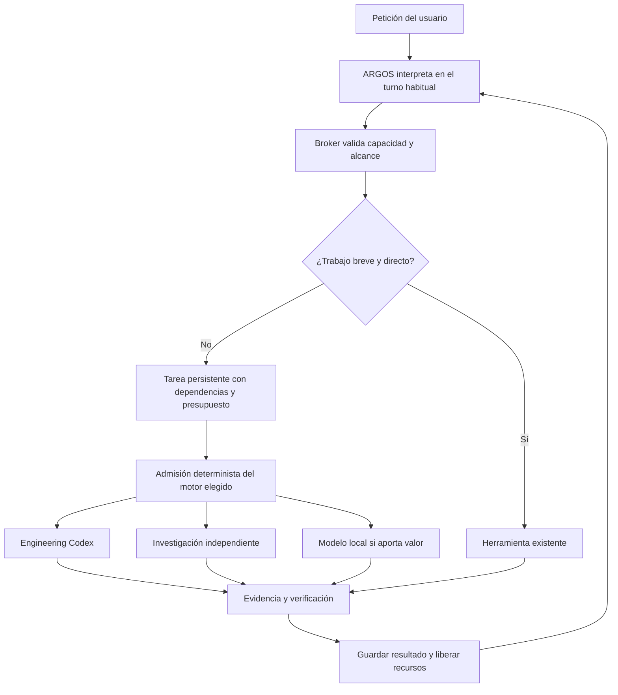

# ARGOS y la delegación adaptativa

2026-11-06. **Propuesta de arquitectura y relevo para el equipo de casa. No implementada.** El objetivo es aumentar el trabajo útil sin hacer esperar a la conversación, usando únicamente las capacidades necesarias. La única suscripción disponible es Codex. Hermes es sustituible: OpenClaw se evaluará también como reemplazo completo, no solo como complemento.

## Punto de partida comprobado

- Base A: `8958bcf`; integración B: `c7e0ca9`. [Informe B y evidencia](block-b-2026-11-06.md). B está habilitado en el piloto instalado; C — aplicación ejecutable y D — mapa/continuidad siguen pendientes.
- El piloto `experiments/hermes-pilot` y su instalación `~/.local/share/argos-hermes-pilot` son distintos del Core operacional `src/argos`. No mezclar sus bases, límites ni garantías. Esta propuesta continúa el piloto.
- Hermes está fijado en `0073fa98cfcf61c066a919df4b336924720f8463`, con la reparación de persistencia validada en A. Sus Projects/Kanban son hoy la autoridad de los proyectos del piloto; las conversaciones viven aparte.
- B permite un Engineering simultáneo, con alcance aprobado, comandos sin red y revisión nativa. Cerrar la conversación no lo cancela. No prueba todavía investigación persistente concurrente, presupuestos comunes de recursos ni tiempos de respuesta bajo carga.
- En `checks/desktop_runtime.py`, General deshabilita `delegation`. `runtime/conversation.py` serializa llamadas de cada trabajador. `WorkspaceBroker.begin_turn()` reinicia fuentes de investigación de la conversación: no sirve como almacenamiento de varias investigaciones independientes.
- `projects/native.py` mantiene un bloqueo del adaptador durante la operación; el despacho puede esperar el arranque del propietario. Para responder pronto habrá que separar la aceptación persistente de la espera de arranque, conservando las comprobaciones de revisión y autoridad.
- Hermes sí contiene delegación, perfiles/proveedores, MCP, skills, propietario/dispatcher de Kanban y cron. **Disponible en el código no significa conectado ni validado en ARGOS.** `tools/delegate_tool_dispatch.py` puede convertir una delegación de fondo en síncrona por falta de soporte de entrega o de cupo. No habilitarla sin resolver ese comportamiento.

Las 353 pruebas del Core, 7 casos nativos, prueba real de Engineering y demás regresiones de B son evidencia anterior. Esta sesión es de inspección y documentación: no añade pruebas de rendimiento ni valida OpenClaw instalado.

## Qué permanece y qué se puede sustituir

ARGOS conserva identidad, interfaz, voz, capacidades, contratos de autorización y resultados verificables. El motor que ejecuta agentes y mantiene tareas puede cambiar. Un agente es un rol con alcance y contexto; no exige un proceso, un modelo ni una suscripción exclusivos.

Debe existir una sola autoridad activa de proyectos/tareas y una sola frontera de permisos. Mientras no haya migración, sigue siendo la integración Hermes de B. Si gana OpenClaw, se migra a su mecanismo nativo que supere las pruebas de persistencia; no se añade una base ARGOS para imitar ambos sistemas. Las vistas y cachés se reconstruyen desde esa autoridad.

La decisión no se toma por cantidad de funciones ni por inversión previa: primero seguridad, continuidad y compatibilidad con Codex; después calidad, respuesta bajo carga, rendimiento útil y mantenimiento. Una ventaja de rendimiento no compensa perder proyectos o ampliar permisos.

## Recorrido de una petición

1. Resolver intención, proyecto y alcance con las herramientas y el turno de General existentes. Una orden conocida puede ir directamente al Broker. No añadir un modelo para routing, acuse, Persona o planificación obligatoria.
2. Distinguir dependencias reales de trabajo independiente. «Construye la aplicación e investiga alojamiento» permite dos ramas; configurar el despliegue sí depende de sus resultados. Una corrección pequeña no necesita descomponerse.
3. Seleccionar una capacidad autorizada y disponible que cumpla la calidad mínima. Entre las elegibles, comparar espera, carga del modelo, ejecución, transferencia de contexto, verificación, cuota y recursos. Usar observaciones recientes, sin otra inferencia ni una exploración global de proveedores.
4. Admitir únicamente lo que cabe en el presupuesto. Devolver el ID y estado observado: aceptado/en espera no equivale a iniciado. El motor nativo conserva la espera y ejecuta al liberarse recursos; el Broker no espera el trabajo completo.
5. Recibir resultado estructurado, verificarlo según la tarea y guardar solo el contexto reutilizable. Liberar el ejecutor; conservar temporalmente un modelo caliente solo cuando ahorre más que su coste de memoria.

Cada encargo lleva proyecto/tarea/revisión, objetivo, brief relevante, entradas y hashes, permisos, carpeta, dependencias, presupuesto y criterio de aceptación. Devuelve intento, estado, evidencias, artefactos, verificación y consumo observado. Se reutilizan campos y registros nativos, ampliando solo lo necesario; no se crea un protocolo universal de agentes.

El especialista puede sugerir otro recurso; solo ARGOS admite esa petición. Inicialmente, una profundidad de delegación y ningún hijo autónomo adicional. Los especialistas intercambian resultados a través de tareas, no mediante conversaciones interminables entre ellos. Cambios de requisitos invalidan verificaciones afectadas; no se acepta evidencia antigua para una revisión nueva.

## Concurrencia y recursos

| Trabajo | Política propuesta |
|---|---|
| Voz, conversación y órdenes breves | Prioridad de admisión; no esperan a Research/Engineering ni al bloqueo de una compilación |
| Engineering | Un escritor por workspace. El límite global inicial sigue siendo uno; ampliar solo con evidencia y espacios separados |
| Research/documentación independiente | Un trabajo de fondo adicional en el primer experimento; lecturas o instantánea estable, resultado propio, sin editar archivos del escritor |
| Tarea dependiente | Permanece en el estado de espera nativo hasta tener entradas válidas; no ocupa un cupo ejecutor |
| Inferencia local | Cero modelos cognitivos nuevos en esta sesión. En casa, máximo uno inicialmente, además de la voz existente y solo si queda margen |
| Tarea pesada o cuota insuficiente | Espera visible y acotada; no se transforma en ejecución síncrona dentro de la conversación |

Estos son límites iniciales del experimento, no una promesa de capacidad del equipo de casa. General y trabajadores remotos pueden competir por la misma cuota de Codex. Reservar margen de admisión para interacción reduce esa competencia, pero no reserva capacidad en el proveedor ni garantiza una respuesta inmediata.

La admisión debe ser común a todas las sesiones/perfiles/proyectos, dentro del propietario nativo: comprobar dependencias, conflicto de escritura, cuota y presupuesto antes de reclamar el trabajo. Límites por perfil o tablero aislados no bastan. Comprobar primero el punto de extensión disponible; si falta, documentar la modificación concreta al motor y su mantenimiento antes de crear otro scheduler. No usar un proceso que sondee y lance trabajadores por fuera del propietario.

Presupuestar CPU, RAM, VRAM, disco temporal, I/O, duración, llamadas y cuota observada. Reservar primero lo que necesitan el escritorio, STT/TTS y las aplicaciones del usuario. En Linux, evaluar límites por grupo de procesos/cgroup y prioridad de CPU/I/O; la VRAM requiere admisión según mediciones, no asumir que esos límites la controlan. No estimar memoria solo por el tamaño del archivo del modelo: incluir contexto y ejecución. Aplicar límites de cola y espera, con envejecimiento acotado para que el fondo no quede olvidado.

Ante presión, dejar de admitir trabajo pesado y liberar modelos inactivos; no descargar y cargar repetidamente con pequeñas oscilaciones. Pausar solo donde haya checkpoint o soporte real: parar un proceso no garantiza liberar VRAM, y una llamada remota no se puede congelar de forma genérica. Cancelar por orden o presupuesto registra el intento y reconcilia efectos antes de continuar. No se promete reanudar en la misma instrucción. Reiniciar ARGOS reconstruye ocupación desde intentos/leases nativos; nunca duplica efectos.

## Comparación de motores y modelos

| Opción | Lo que aporta o ya está demostrado | Lo que decide su adopción |
|---|---|---|
| Hermes actual | A/B reales, Projects/Kanban, recuperación, Codex y Broker integrados | Entrega desacoplada, cupos comunes y Research persistente sin el fallback síncrono; coste de adaptar sus mecanismos existentes |
| OpenClaw como reemplazo | Documenta subagentes, concurrencia, Codex App Server y Workboard con dependencias/intentos | Repetir A/B con iguales permisos; demostrar proyectos independientes de sesiones, rendimiento, migración y conservación de la experiencia ARGOS |
| OpenClaw como complemento | Posible integración concreta de canales o servicios | Solo si reduce trabajo sin añadir otra autoridad ni inferencia redundante. No es el destino obligatorio de la evaluación |
| Ollama | Gestión existente de carga, `keep_alive`, límites de modelos y peticiones | Primera opción local a comparar por integración previa; un modelo pequeño, calidad suficiente y beneficio incluyendo arranque frío |
| llama.cpp server | Servidor con ejecución CPU/GPU, control de hilos y procesamiento paralelo | Alternativa si ofrece una ventaja medida o control que Ollama no dé. No instalar ambos por defecto |

OpenClaw es un candidato serio: su documentación actual distingue el runtime nativo Codex con autenticación de suscripción de la ruta ACP, y ofrece Workboard para trabajo persistente. Esto justifica compararlo como base completa, pero no demuestra que sea más rápido en este equipo ni equivalente al aislamiento de A. [Runtimes de OpenClaw](https://docs.openclaw.ai/concepts/agent-runtimes), [Workboard](https://docs.openclaw.ai/plugins/workboard), [concurrencia](https://docs.openclaw.ai/concepts/parallel-specialist-lanes).

Workboard también documenta que sus trabajadores reciben `workboard_complete`. La comparación debe comprobar cómo separar esa declaración del trabajador de la aceptación confiable de ARGOS; la configuración predeterminada no se considerará equivalente a la revisión de B. [Herramientas de Workboard](https://docs.openclaw.ai/plugins/workboard#agent-tools).

Hay una diferencia concreta que probar: su App Server puede tener `CODEX_HOME` por agente mientras conserva el `HOME` del usuario. Esa separación de configuración no demuestra por sí sola aislamiento de archivos/credenciales. Repetir los canarios de A, sin copiar la sesión del IDE. Fijar versión de OpenClaw y su Codex antes de validar; no activar herramientas, plugins o autoactualizaciones por omisión. [Política del App Server de OpenClaw](https://docs.openclaw.ai/plugins/codex-harness/app-server).

Ollama permite mantener y descargar modelos, pero el paralelismo también aumenta memoria de contexto. Por eso conviene medir un modelo compartido caliente frente a recargar especialistas, y valorar la descarga por inactividad/presión. llama.cpp es una alternativa de ejecución, no otro coordinador. [Ollama FAQ](https://docs.ollama.com/faq), [llama.cpp server](https://github.com/ggml-org/llama.cpp/blob/master/tools/server/README.md).

Con Codex como única suscripción, se mantiene la ruta de autenticación ya validada y los modelos efectivamente disponibles; no se cambian ahora. Login de suscripción y acceso mediante clave API son rutas diferentes. No presupuestar APIs ilimitadas, cuentas gratuitas ni nuevas suscripciones. Si más adelante se propone un proveedor gratuito, comprobar primero cuota, calidad, privacidad y disponibilidad; nunca sustituir silenciosamente por pago. [Autenticación oficial](https://learn.chatgpt.com/docs/auth).

## Secuencia de trabajo y criterios de salida

| Paso | Entrega concreta | Dónde y cuándo se cierra |
|---|---|---|
| 0. Relevo | Esta propuesta, base A/B y decisiones pendientes; ninguna instalación ni cambio de runtime | Esta sesión |
| 1. Línea base | Inventario del equipo, copias coherentes del estado, versiones y medidas de ARGOS libre/ocupado | En casa, antes de cambiar el motor |
| 2. Comparación acotada | Probar Hermes y OpenClaw aislados con la misma tarea, modelo, alcance y protocolo; elegir motor y registrar motivos | En casa; no habilitar ambos sobre proyectos reales |
| 3. Hito mínimo de delegación | Engineering e investigación persistentes independientes, respuesta foreground y cupos verificables | Implementación posterior a la decisión; apagada hasta pasar las pruebas |
| 4. Inteligencia local bajo demanda | Evaluar un modelo y un runtime; medir frío/caliente, presión y descarga | Solo si mejora calidad/coste/tiempo frente a herramientas y Codex |
| 5. C y D | Retomar aplicación ejecutable y mapa con el motor elegido y los presupuestos ya comprobados | Hitos separados; no iniciados por este plan |
| 6. Operación continua | Responsabilidades autorizadas, servicios/canales y automatización recuperable | Después; cada integración debe justificar su necesidad |

**Prueba mínima del paso 3:** pedir «construye una aplicación de notas e investiga dónde alojarla» sobre una fixture autorizada. Engineering produce código/pruebas; Research produce fuentes y una comparación sin contratar ni desplegar nada. Mientras ambos progresan, pedir «abre Firefox», consultar estado y comenzar otro proyecto. Medir que la atención nueva no espera a terminar los trabajos; el segundo Engineering puede quedar en cola. Cerrar/reabrir la UI, reiniciar el propietario y repetir una entrega: continuidad sin duplicados ni mezcla de fuentes. Si no hay cupo, devolver espera y mantener la conversación libre.

Usar native tasks también para Research y persistir su evidencia fuera del transcript. No dar red al shell de Engineering: Research utiliza capacidades web registradas por el Broker. Sus fuentes/UI deben estar asociadas a tarea/intento, no al único `research_epoch` de la conversación. El trabajo documental que dependa del código espera una revisión estable; no fingir independencia.

Para comparar motores, exigir primero la suite funcional/seguridad de A/B y preservación de voz, apps, navegador, archivos, memoria y mantenimiento. Después medir p50/p95 de entrada a primer texto/audio y efecto local, tiempo total de la tarea, trabajos correctos por minuto, llamadas/tokens disponibles, RSS/RAM/VRAM, CPU, I/O y almacenamiento. Separar arranque frío, caliente, espera de cuota y tiempo del proveedor. Usar pruebas alternadas y repetidas en la misma máquina/modelo, publicando muestra y variación; un caso rápido no decide.

Criterios: cero llamadas nuevas solo para enrutar; cero inferencias de especialistas ociosos; ningún exceso de cupo, fuga o replay; calidad equivalente; conversación sin regresión material. Mantener como objetivo propuesto los 100 ms de sobrecoste local del plan previo, medidos fuera del proveedor. Fijar el margen tolerable de p95 tras la línea base y antes de comparar; si los resultados son ruidosos, la mejora queda sin demostrar. No certificar velocidad con las pruebas lentas de este equipo.

## Si gana OpenClaw

La migración es una opción prevista, no una pérdida aceptable de funciones. Ensayar en una copia aislada: proyectos/alias/briefs, tareas/dependencias, intentos/eventos, evidencias y referencias a archivos deben tener correspondencia verificable. Mantener identificadores de origen y distinguir evidencia importada de nuevas verificaciones. No asumir portabilidad de un hilo remoto: conservarlo cuando el motor lo soporte, o continuar desde un checkpoint explícito.

Antes del cambio real: detener nuevas admisiones, resolver intentos activos, respaldar con las herramientas nativas y verificar recuentos/huellas. Activar un único escritor y conservar el anterior inactivo para vuelta atrás. Durante el ensayo no modificar proyectos reales. Si ya hubo efectos nuevos tras el corte, volver atrás exige reconciliar esos efectos y registros; restaurar una copia vieja no basta. Mantener contratos de permisos de A, aunque se sustituya su implementación de transporte. La migración necesita su propia validación y activación revisable.

## Proyección posterior

Una tarea entrega un resultado; un proyecto conserva objetivos y decisiones; una responsabilidad autoriza operaciones repetidas con condiciones, presupuesto, vencimiento y pausa. Reutilizar cron/eventos del motor elegido para lo repetitivo, sin inferencia si no hace falta juicio. Registrar cada ejecución y evitar duplicados tras reinicios. El acceso a una cuenta no autoriza publicar, enviar mensajes, pagar ni actuar sobre hardware.

Si falta una capacidad, ARGOS prepara una propuesta con utilidad, alternativa existente, espacio, recursos, coste, permisos, validación y retirada. Solo tras la decisión correspondiente se instala y registra. Descubrir metadatos no arranca ejecutores ni importa plugins desconocidos. La selección automática posterior queda limitada al conjunto ya aprobado.

El mapa visual será una proyección de objetivos, dependencias, decisiones, agentes activos y artefactos reales; editarlo emitirá operaciones del Broker con control de revisión. Cerrarlo no detiene nada. Recomiendo primero un panel nativo en la interfaz azul existente. Obsidian Canvas ofrece un formato abierto útil para exportación/consulta, pero haría falta integrar cualquier edición para que no se convierta en otra autoridad. [Obsidian Canvas](https://obsidian.md/help/plugins/canvas).

La interfaz de capacidades separa lógica de negocio de proveedor y plataforma, sin construir ahora un framework genérico. Linux es la base validada; Windows necesita pruebas propias de rutas, procesos, audio, aplicaciones y aislamiento antes de afirmar equivalencia. CAD, visión, multimedia, canales y operación física entran como capacidades futuras con su alcance; no como agentes residentes por defecto.

## Relevo para Codex en casa

1. Leer este plan, el informe B y `LOCAL-NOTES.md`. Confirmar rama/commit y cambios locales. El siguiente trabajo es **línea base y comparación de motores**, no implementar C/D ni declarar adoptado OpenClaw.
2. Inventariar SO, CPU, RAM, GPU/VRAM, espacio y periféricos reales. Conservar Peter/Qwen/Whisper y la opción CUDA; no trasladar como definitivo el ajuste CPU de este PC. Recuperar la extensión firmada Firefox 0.1.4 del otro equipo.
3. Revisar `installation.json` y rutas del nuevo equipo. El repositorio transporta código, plantillas y evidencia saneada, **no** entornos, modelos, cuentas, bases privadas ni instalaciones. `scripts/prepare_hermes_pilot.py` prepara fuentes; no resuelve todas las dependencias. No ejecutar scripts de proof sobre una instalación existente sin leer su alcance.
4. Si se quieren trasladar proyectos/conversaciones reales, hacer una copia privada coherente de sus almacenes nativos y archivos con los propietarios detenidos; comprobar hashes y referencias. No meterla en Git ni copiar el auth del IDE. Autenticar cada entorno de prueba mediante su flujo soportado y mantener cuotas compartidas visibles.
5. Crear entornos comparativos desechables con versión fijada; instalar OpenClaw solo para la comparación autorizada y con espacio presupuestado. Revisar las fuentes oficiales de esta propuesta: describen la consulta del 6 de noviembre, no una versión fijada ni un benchmark.
6. Ejecutar controles estáticos y pruebas dirigidas primero. Después, según cambios, regresión `PYTHONPATH=src python -m unittest discover -s tests -v` y pruebas nativas del piloto. Las pruebas reales de suscripción, voz/GPU, concurrencia, presión de recursos y recuperación se hacen en casa, con fixtures y salida de audio controlada; no sobre proyectos del usuario.
7. Guardar cada avance como commit y una entrada breve de estado: versión, prueba/comando, resultado, artefactos saneados, limitación y próximo paso. Lo aplazado se registra como pendiente, nunca como aprobado. No guardar credenciales, audio ni razonamiento privado.

**Pendiente al cerrar esta sesión:** medir en casa, validar OpenClaw con Codex y decidir motor. No se han descargado modelos, instalado agentes, alterado cuotas/concurrencia, desplegado este plan ni iniciado C/D. Las instalaciones y pruebas pesadas se aplazan según la indicación del usuario.
