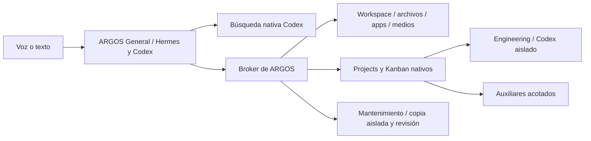

# ARGOS — inventario real y capacidades pendientes

8 de noviembre de 2026. Auditoría del repositorio y del piloto instalado en casa. **Una capacidad disponible, una librería instalada y un agente ejecutándose son conceptos distintos.** Se inspeccionaron registros, esquemas, configuración, dependencias y estado local; no se instalaron Perplexity, Tavily, SearXNG, Agent Desktop ni nuevas automatizaciones.

Evidencia estructurada: [herramientas y disponibilidad](capability-inventory-2026-11-08.json), [todos los paquetes y versiones](library-inventory-2026-11-08.json). Validación previa: [integración en casa](home-integration-2026-11-08.md).

## Resumen cuantificado

| Concepto | Estado observado |
|---|---|
| Motor principal de la app habitual | Hermes Agent, pin `0073fa98cfcf61c066a919df4b336924720f8463`, con parche acotado de persistencia validado |
| Proveedor cognitivo activo | Codex App Server con la suscripción ya autenticada; `gpt-6-luna`, esfuerzo low |
| Rutas con modelo implementadas | 3: conversación General, Engineering de proyectos y mantenimiento de ARGOS; las últimas dos se activan bajo demanda |
| Servidores MCP propios por contexto | General: `argos-workspace`. Engineering: `hermes-tools` restringido a cinco herramientas de handoff |
| Grupos del Broker anunciados a General | 8, con 51 operaciones en sus esquemas; no incluye acciones de aprobación reservadas al usuario |
| Auxiliares Adaptive | 5 implementaciones registradas, 4 disponibles; `local.extract` no disponible en la configuración actual |
| Interfaz principal | 1 app Electron, 2 entradas (voz y panel opcional de texto), 14 tipos de ventana interna |
| Navegadores involucrados | 2 motores/perfiles: navegador integrado de Electron y Firefox habitual con extensión de medios |
| Catálogo de apps externas | 9 ejecutables disponibles por inventario; no se lanzaron todos durante esta auditoría |
| Entornos Python relevantes | 3: Hermes, reconocimiento y síntesis |
| Paquetes Python instalados | 250 registros entre esos entornos; 163 nombres distintos; 23 nombres tienen versiones diferentes entre entornos. Incluye transitivos y paquetes sin uso activo |
| Límites de trabajo Projects/Adaptive | Un escritor Engineering y un auxiliar; reserva de RAM configurada de 2 GiB. Mantenimiento tiene su propio controlador, no se afirma un único presupuesto global para todas las rutas |

Las plantillas históricas no son el inventario activo. Por ejemplo, `config-templates/hermes-config.yaml` todavía menciona Gemini, mientras `checks/desktop_runtime.py` fuerza la conversación a Codex. La disponibilidad anterior de Gemini/NVIDIA/Ollama no los convierte en proveedores conectados ahora.

## Agentes y responsabilidades

| Ruta o componente | Qué hace | Modelo/ejecución | Estado y límite |
|---|---|---|---|
| ARGOS General | Conversación, personalidad, interpretación, decide cuándo usar capacidades | Hermes `AIAgent` + Codex `gpt-6-luna/low` | Activo en la app. Una personalidad; no hay otro modelo para routing |
| Engineering de proyectos | Programa y ejecuta comandos/tests en una carpeta autorizada; solicita revisión | Perfil nativo Hermes/Kanban + Codex `gpt-6-luna/low` | Probado con biblioteca 3D CLI; propietario/claims/runs nativos, un escritor, alcance por proyecto |
| Mantenimiento de ARGOS | Prepara cambios o correcciones en una copia de la app, valida y presenta revisión | Sesión nativa Codex `gpt-6-luna/low` y controlador existente | Probado. Instalación/reinicio/reversión revisados; editable limitado a archivos concretos de la app |
| Auxiliar de capacidades | Normalización, inventario, agregación, documentación acotada | Funciones deterministas/red; perfil nativo para tareas | No es un segundo agente conversacional |
| Whisper y Qwen/Peter | Reconocimiento y síntesis | Workers locales CUDA | Modelos de audio, no agentes de planificación |
| Investigación web | Búsqueda nativa, selección de fuentes y entrega incremental al workspace | General + herramienta nativa `web_search` y Broker | No hay un Research Agent independiente conectado |
| Control del PC actual | Archivos, particiones y apertura de apps | Broker y funciones locales | No hay un agente de escritorio con control general de otras aplicaciones |

El panel «Agentes» actual dibuja ARGOS/Hermes/Codex y estados de conexión. **Esos tres nodos no representan tres agentes independientes.** El Project Map sí proyecta tareas/runs/asignaciones nativas. Falta un inventario dinámico de perfiles, herramientas efectivas, carga y permisos para sustituir el diagrama conceptual.

El Core clásico en `src/argos/agents.py` define seis roles: `general`, `engineering`, `computer`, `research`, `design3d`, `printing3d`. Pertenecen a la consola/ruta clásica y no son seis especialistas conectados a la app Hermes. Hay inspectores STL/G-code implementados en ese Core; no están expuestos como capacidades actuales del Broker del piloto.

## Todas las herramientas anunciadas por el Broker

| Grupo | Operaciones del modelo | Funcionalidad actual |
|---|---|---|
| `apps` (2) | `list`, `open` | Descubrir y lanzar ejecutables del catálogo; URL HTTPS opcional solo para Firefox |
| `development` (4) | `status`, `show`, `propose`, `review` | Contexto de la app, autolog y propuestas de mantenimiento; el modelo no instala su propia propuesta |
| `workspace` (12) | `inspect`, `open`, `close`, `clear`, `focus`, `minimize`, `restore`, `maximize`, `move`, `arrange`, `research_sources`, `research_result` | Control de ventanas internas, observación de selección, fuentes y resumen hablado/textual |
| `files` (8) | `list`, `search`, `read`, `open`, `copy`, `paste`, `clipboard`, `propose` | Explorador, lectura/visor, clipboard y cambios propuestos para revisión |
| `storage` (3) | `inspect`, `show`, `browse` | Discos, particiones, montajes y espacio observado; navegación por volúmenes ya montados |
| `media` (2) | `status`, `play` | Música por el Firefox habitual y verificación acotada de reproducción |
| `projects` (13) | `list`, `activity`, `resolve`, `propose`, `update`, `task_create`, `task_update`, `dependency`, `tasks`, `task`, `dispatch`, `open_map`, `map` | Proyectos, requisitos/decisiones, tareas, dependencias, ejecución y mapa nativos |
| `adaptive` (7) | `catalog`, `submit`, `status`, `tick`, `cancel`, `workflow`, `canvas` | Red acotada de funciones sobre tareas nativas, DAG y exportación JSON Canvas |

General dispone además de la búsqueda web nativa de Codex. Los comandos y las herramientas de edición de Codex se usan dentro de Engineering/mantenimiento autorizados, no como una shell general del PC para la conversación.

Las cinco herramientas MCP de handoff de Engineering son `kanban_show`, `kanban_heartbeat`, `kanban_comment`, `kanban_block`, `kanban_request_review`. La aprobación de alcance, verificación/aceptación/rechazo y autorización de reintentos pertenecen a la superficie confiable del usuario; no forman parte de las 51 operaciones del modelo.

Adaptive tiene:

- `text.normalize`: transforma una lista explícita; disponible.
- `files.inventory`: metadatos de archivos visibles y regulares en la raíz del proyecto, no inventario ilimitado de discos; disponible.
- `files.types`: cuenta extensiones de un resultado padre; disponible.
- `research.documentation`: lee dos páginas oficiales concretas, `sqlite3` y `pathlib`; disponible. **No equivale a un buscador web general.**
- `local.extract`: adaptador Ollama para un modelo/digest revisado; implementado pero no disponible. La instalación tiene `adaptive.local={}` y no carga otro modelo cognitivo por esta vía.

Apps disponibles en el catálogo: Firefox, Visual Studio Code, Code OSS, Dolphin, Calculadora, Discord, Steam, mpv y qView. Es inventario de ejecutables; abrir una app no demuestra una ventana visible ni concede autoridad para operar sus controles.

## Interfaces y comunicación

La experiencia habitual es **una app**: workspace azul, orb, sonido, ventanas movibles y redimensionables, entrada de voz y texto opcional. Los 14 tipos internos son: proyectos, conversación, progreso, resumen, fuentes, navegador, vídeo, agentes, notas, archivos, documento, revisión de cambio, almacenamiento y mantenimiento. Son paneles del mismo programa, no 14 aplicaciones.

| Superficie | Estado |
|---|---|
| Workspace propio Electron | Interfaz habitual y probada en Linux/Hyprland mediante XWayland/render software |
| Navegador integrado | `WebContentsView`, hasta cuatro páginas remotas, perfil separado del Firefox habitual; navegación/capturas/previsualización, controles manuales |
| Firefox + ARGOS Media Bridge | Auxiliar externo para música, extensión firmada 0.1.4 permanente y puente conectado en esta inspección |
| Consola ASCII del Core clásico | Ruta alternativa existente; no es la interfaz del piloto Hermes ni está unificada automáticamente con él |
| Desktop nativo de Hermes y webs de muestras | Superficies de evaluación/históricas; no son otras interfaces habituales conectadas al workspace actual |

Comunicación interna: HTTP loopback para controles/estado, SSE para eventos, IPC/preload de Electron, socket Unix del Broker, MCP stdio para herramientas, JSON/RPC stdio del App Server y mensajes JSON de workers de voz; Firefox añade Native Messaging/socket local. Projects usa el protocolo nativo del propietario Hermes y SQLite. PipeWire transporta audio. Son enlaces entre componentes, no agentes adicionales.

El contexto del workspace incluye IDs de ventana, proyecto/tarea y archivo seleccionado. **Todavía no incluye observación general del DOM de la página integrada ni comprensión de todas las ventanas del escritorio.**

## Funcionalidades: completas, parciales y ausentes

| Área | Estado actual | Trabajo pendiente |
|---|---|---|
| Voz natural y personalidad | Peter/Qwen, PCM progresivo, Whisper turbo CUDA, EN/ES, invocación local; respuesta hands-free confirmada | Robustez por ruido/acento, pruebas manuales completas de idioma/interrupción, medidas p50/p95 de extremo a extremo |
| Rapidez | Cachés, calentamiento y reutilización de sesión existentes; respuestas simples medidas | Coste del primer arranque, consultas largas y latencia por etapa; no atribuirlo todo al modelo |
| Errores | Autolog acotado, etapas de arranque y salud separada | Diagnosticar los fallos nativos incompletos; distinguir con evidencia cancelación, resultado parcial y fallo real |
| Investigación | Búsqueda nativa y entrega incremental de fuentes/ventanas/resumen | Proveedor opcional gratuito comparado, mejor progreso por fases y navegación con interacción |
| Workspace | Ventanas, disposición, abrir/cerrar/limpiar, selección contextual, feedback sonoro | Temas por voz, rediseño persistente, mejor gestión del espacio y diagrama real de agentes |
| Archivos y almacenamiento | Exploración, búsqueda, texto/PDF/imágenes, copiar/pegar y cambios revisados; discos/montajes observados | Formatos especializados, búsquedas más amplias con alcance y operaciones de sistema explícitas |
| Navegador integrado | Abrir páginas/vídeos y controles manuales; aislamiento y restricciones de red | Leer DOM, localizar controles, rellenar, pulsar y verificar acciones mediante una capacidad acotada |
| Aplicaciones externas | Lanzamiento de apps conocidas | Descubrir/operar controles de apps con observación y permisos por aplicación |
| Proyectos y programación | Projects/Kanban, Engineering, revisión independiente, artefactos y continuación probados | Proyectos mayores, presupuesto/modelo por tarea, recuperación de más escenarios y app gráfica generada/lanzada de forma acotada |
| Memoria | Historial/sesiones/hilos nativos y verdad persistente de proyectos | Memoria personal reactiva y skills realmente accesibles desde General, probadas sin duplicar almacenes |
| Automejora | Propuestas por voz con Codex, revisión, actualización y rollback | Mayor cobertura de diagnóstico; algunas fuentes del runtime quedan fuera del editable de mantenimiento |
| Diseño 3D | Biblioteca 3D CLI de demostración; inspectores STL/G-code en Core clásico | Especialistas CAD, Blender/FreeCAD/Fusion 360, edición, previsualización y validación de modelos en la app actual |
| Impresión 3D | Sin conexión operativa de impresora o slicer en el Broker actual | Bambu/otro slicer, perfiles/materiales, slicing, telemetría, simulación y autorización de acciones físicas |
| Automatización duradera | Trabajo nativo bajo alcance y concurrencia acotada | Agenda/eventos/monitorización autorizada, recuperación ante apagado, presupuestos globales y escalado de modelos medido |
| Plataformas | Linux/Hyprland probado | Windows: rutas, procesos, audio, apps y aislamiento con pruebas reales; la portabilidad de Electron no basta |

Reconocimiento actual: espera la frase y el final de voz mediante endpoint energético; no hay un modelo dedicado de wake word independiente. El orb reacciona al PCM de salida. Síntesis progresiva no implica que se esté generando audio por cada token de texto: respeta los límites de mensaje público del transporte.

La memoria nativa existe y la configuración exterior de General declara `memory/skills`, pero eso no prueba herramientas de escritura de memoria en cada turno de Codex. En esta configuración General anuncia `argos-workspace`; el puente nativo `hermes-tools` excluye `memory` de su lista y el trabajador solo tiene cinco handoffs. No se presenta la memoria personal automática como completada por el hecho de que las sesiones y los proyectos persistan.

## Librerías y herramientas de sistema

El [JSON completo](library-inventory-2026-11-08.json) enumera nombre y versión de cada distribución en los tres entornos. No contiene credenciales ni URLs de instalación. Que una dependencia esté instalada no significa que su servicio esté habilitado.

| Capa | Componentes relevantes observados |
|---|---|
| Base ARGOS | Python, `asyncio`, `threading`, `subprocess`, `sqlite3`, `json`, `http.server`, `urllib`, `socket`, `hashlib`; el paquete `argos-core` declara cero dependencias externas |
| Hermes/Protocolos | Hermes pin fijado, `mcp 2.3.0`, `pydantic 2.14.1`, `httpx 0.28.1`, `psutil 7.2.2`; `rich 14.3.4` y `prompt_toolkit 3.0.53` para superficies nativas |
| Reconocimiento | Python 3.12.15, `faster-whisper 1.2.1`, `ctranslate2 4.8.3`, `numpy 2.5.4`, `onnxruntime 1.31.0` y librerías CUDA/cuDNN |
| Síntesis | Python 3.12.15, distribución `qwen-tts 0.1.1` y motor streaming local fijado `b8db6ff1cebc0d6554cf0977045850bcc796b383`; modelo Qwen3-TTS Base con referencia Peter |
| Cómputo de voz | `torch 2.11.0+cu128`, `torchaudio 2.11.0+cu128`, `transformers 4.57.3`, `soundfile 0.14.0`, NumPy, Safetensors, Hugging Face Hub y dependencias NVIDIA/Triton |
| Escritorio | Node 26.12.1, Electron 44.9.3, HTML/CSS/JS propios, Canvas/Web Audio y gestor propio de ventanas |
| Pruebas | Playwright/Playwright Core 1.64.0, `unittest`, pytest del entorno nativo y scripts de integración |
| Aislamiento y datos | Bubblewrap (`bwrap`), política de permisos Codex, Git, SQLite y API nativa de Hermes |
| Audio y documentos | PipeWire (`pw-record`, `pw-play`, `pw-cli`, `pw-dump`), `pactl`, FFmpeg y `pdftotext`; `lsblk` para almacenamiento |
| Dependencias instaladas que no implican servicios activos | FastAPI/Uvicorn, SDKs y otras dependencias de Hermes/Qwen; el host habitual usa `http.server`, y la UI propia no usa React/Vue por tenerlos disponibles en el vendor |

El entorno STT también contiene PyTorch CPU; el reconocedor activo usa **CTranslate2 en CUDA**, no ese PyTorch para la inferencia Whisper. Las diferencias de versiones entre entornos separados no son por sí mismas una incompatibilidad.

## Nuevas capacidades solicitadas

### Búsqueda: Perplexity y alternativas gratuitas

La búsqueda actual ya funciona a través de Codex y su cuenta/cuota existente, sin otra clave de búsqueda configurada. Sigue siendo la base inmediata.

Perplexity **Search API** devuelve resultados estructurados y extractos que General puede sintetizar, sin incorporar otro agente generador de respuestas. Su tarifa pública consultada es 5 USD/1000 peticiones estándar y 1 USD/1000 Fast Search. Está sin conectar y queda condicionado a la restricción de pagar solo Codex. La web gratuita no prueba acceso API gratuito. [API](https://docs.perplexity.ai/docs/search/quickstart), [tarifas](https://docs.perplexity.ai/docs/getting-started/pricing).

Alternativas para evaluar, sin alta ni instalación en esta auditoría:

| Opción | Coste y alcance | Encaje propuesto |
|---|---|---|
| Búsqueda nativa actual de Codex | Cuenta/suscripción existente y sus límites | Mantener como base; medir resultados/latencia antes de reemplazarla |
| Tavily Search gratuito | 1000 créditos/mes sin tarjeta; básica 1, avanzada 2 | Piloto API sencillo con cuota local y corte al agotarla; no fallback de pago. [Tarifas oficiales](https://docs.tavily.com/documentation/api-credits) |
| SearXNG propio | Software libre AGPL, coste del PC/red y mantenimiento; sin tarifa de API por sí mismo | Candidato para independencia de otra cuenta: Broker → HTTP JSON loopback → resultados → General. [Proyecto](https://github.com/searxng/searxng), [API](https://docs.searxng.org/dev/search_api) |

SearXNG agrega motores externos: no hace la búsqueda de Internet fuera de línea ni elimina bloqueos de esos motores. En una instancia propia se debe habilitar JSON; muchas públicas lo deshabilitan, y los operadores públicos pueden registrar consultas. Para un piloto propio hay que medir calidad, fallos, CPU/RAM y mantenimiento. [Instancia privada](https://docs.searxng.org/own-instance.html).

Mi propuesta para comparar es conservar el proveedor actual y medir Tavily gratuito o SearXNG, eligiendo uno por resultados. No añadir simultáneamente varios servicios ni un modelo Research adicional para compensar una búsqueda no evaluada.

### Playwright para el navegador integrado

**Instalado y probado como QA; no conectado como herramienta operativa de General.** El objetivo es observar DOM/accesibilidad, encontrar controles, rellenar/pulsar, esperar cambios y verificar resultados en las pestañas concretas del workspace.

La integración recomendada es un adaptador de navegador en el Broker que opere únicamente los `WebContentsView` autorizados. Playwright documenta soporte experimental para Electron; `connectOverCDP` es Chromium y ofrece menor fidelidad que su protocolo propio. Electron dispone también de un transporte CDP por `webContents.debugger`. Es una ruta candidata que requiere prueba con las versiones instaladas, no una compatibilidad ya demostrada para nuestros guests. [Electron en Playwright](https://playwright.dev/docs/api/class-electron), [CDP](https://playwright.dev/docs/api/class-browsertype#browser-type-connect-over-cdp), [Debugger de Electron](https://www.electronjs.org/docs/latest/api/debugger/).

No exponer a General `electronApplication.evaluate` sobre el proceso principal: esa API puede tener autoridad de host. El contrato útil es observación y acciones estructuradas por pestaña/origen, conservando las restricciones de red y separando envío/publicación/descargas de la mera lectura. El contenido de una página no concede permisos.

### Agent Desktop para aplicaciones del PC

**Evaluado documentalmente; no instalado ni habilitado.** El repositorio correcto es Vercel, no otros proyectos homónimos. No contiene un modelo de IA: aporta observación/acciones mediante accesibilidad y el razonamiento seguiría en General. [README v1.2.0](https://github.com/vercel-labs/agent-desktop/blob/v1.2.0/README.md).

Primer piloto: aplicación de prueba, ventana/proceso identificados, snapshot AT-SPI, acción semántica y verificación. En Linux usa AT-SPI/D-Bus. La documentación exige Mutter para ciertas teclas Wayland y marca control de ventanas/gestos como no soportado en esa ruta; Hyprland necesita validación específica. No prometer control universal a partir del soporte Linux. [Plataforma Linux](https://agent-browser.dev/desktop/platforms/linux).

### Personalización de ARGOS por voz

**Actual:** ventanas/disposición controlables por voz; CSS/HTML/JS editables indirectamente mediante mantenimiento Codex, con revisión y reinicio. No hay todavía un `theme` del Broker para cambiar colores en vivo.

Dos entregas propuestas:

1. **Preferencias de apariencia:** paleta, tipografía/tamaños, densidad, intensidad de brillo, animación y sonidos mediante parámetros validados; guardar configuración, aplicar en vivo y permitir deshacer. «Usa azul eléctrico y ventanas más compactas» debería producir un cambio inmediato y reversible sin programar la app.
2. **Rediseño estructural:** para «quiero otra composición del orb y los paneles», preparar una copia con Codex, mostrar preview/diff, comprobar interacción y aplicar por el flujo existente de actualización/reversión. La autorización de un tema no autoriza reescribir controlador, permisos o integración de cuentas.

Las preferencias de tema pertenecen a la configuración de UI. Los proyectos/tareas siguen en Hermes; no hace falta otra memoria ni otro runtime para personalizar el estilo.

## Error observado y prioridad de fiabilidad

Se confirmó en la instalación `phase=listening`, `voice_ready=true` y un `error` anterior todavía presente. `Conversation.state()` conserva valores previos; `app.js` vuelve a presentar `value.error` en cada actualización. Por eso una petición nueva podía estar pensando/contestando y a la vez mostrar el aviso anterior.

La corrección `a017516` borra ese error al aceptar un nuevo turno dirigido o una invocación, y conserva el error ante audio de standby que no es una petición. Dos regresiones verifican ambos caminos. **361 tests pasan.** La UI también retira el error mostrado al reactivar con una invocación, conservando la transcripción nueva: ocho comprobaciones del renderer pasan. Se desplegó el cambio y se reabrió la app.

Hay además tres incidencias nativas `Native conversation did not complete`. El registro no conserva sus flags originales suficientes para establecer su causa. Corregir el aviso persistente no permite afirmar que todos esos turnos fueron exitosos ni justificar ignorar `completed=false`. Sigue pendiente discriminar transporte, cancelación, contenido parcial y finalización nativa con metadatos saneados.

Que mejore tras los primeros turnos es compatible con calentamiento/reutilización de sesión y cachés observados, pero no demuestra que «aprenda» ni identifica por sí solo la causa de cada espera. La primera preparación de Qwen llegó a 149 s y las siguientes a 18–19 s. Las respuestas cortas medidas rondaron 1–3 s hasta primer audio; una consulta al proyecto en la conversación original tardó unos 16 s. Hace falta comparar las mismas tareas con trazas por etapa, sin borrar historial para aparentar una mejora.

## Orden propuesto hacia el objetivo final

1. **Fiabilidad y contexto:** aviso persistente corregido; diagnosticar turnos incompletos, separación de temas, memoria personal realmente accesible, primer arranque y latencias por etapa. Confirmar idioma/interrupción por oído.
2. **Navegación útil:** interacción acotada del navegador integrado con Playwright/CDP, fuentes/progreso observables; comparación de búsqueda existente con una alternativa gratuita si aporta mejora.
3. **Apariencia por voz:** parámetros de tema, persistencia y deshacer; después rediseño estructural mediante la actualización revisada existente.
4. **Escritorio externo:** piloto Agent Desktop en una app y validación Hyprland antes de ampliar a exploradores, editores o CAD.
5. **Trabajo prolongado y programación:** política de modelo/presupuesto por tarea, checkpoints y recuperación real ante interrupción; apps generadas con lanzamiento/visor propio acotado. Mantener una única autoridad nativa Projects/Kanban.
6. **3D y fabricación:** elegir herramienta CAD/slicer e integrar lectura/edición verificable; validar geometría, unidades, tolerancias, perfiles y resultados antes de accionar impresoras. Fusion 360/Bambu/Blender/FreeCAD aún no son especialistas conectados.
7. **Objetivo completo:** diagrama vivo de agentes/capacidades, automatizaciones autorizadas, personalización estructural más amplia y paridad Windows demostrada. Integraciones de correo/agenda/mensajería quedan como módulos posteriores, no servicios conectados hoy.

El siguiente incremento no necesita otro coordinador, otro agente de personalidad ni otro almacén de memoria. Necesita completar y verificar las capacidades concretas que General solicita al Broker.
