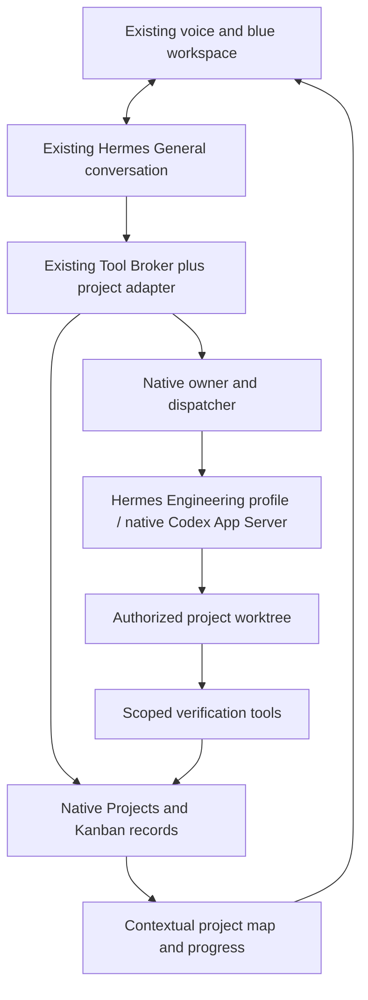

# ARGOS persistent project intelligence — implementation proposal

2026-11-05. **Planning only; no runtime, configuration, provider, project or task changes have been made for this proposal.**

## Decision

Extend the working isolated ARGOS/Hermes app. Preserve its current conversation, personality, bilingual streaming voice, hands-free capture, interruption, incremental research, blue workspace, files/storage, application launch, signed Firefox media bridge and reviewed self-updates. Keep the operational ARGOS repository and active IDE sessions protected.

Use the pinned Hermes Project registry and Kanban lifecycle as the authoritative project/task system. Add a small, policy-checked integration into the current broker and presentation. Do not introduce another agent loop, scheduler, task database, general memory store or mandatory research→plan→code pipeline. Keep current provider/model choices; higher model settings would be a separate deliberate per-task policy choice.

## What inspection establishes

| Foundation | Evidence and present limit |
|---|---|
| Working voice/workspace | Live app reports ready, listening, Codex App Server, gpt-6-luna and streaming voice. Existing behaviour is the compatibility baseline. |
| Native projects | `hermes_cli/projects_db.py` implements project IDs, descriptions, folders, primary paths and board links; `tools/project_tools.py` implements intentional creation/switching. The inspected pilot projects DB has zero projects. Not integrated or demonstrated through the voice app. |
| Native persistent work | `hermes_cli/kanban_db.py` implements project-linked tasks, dependency links, runs, claims, heartbeat, comments, events and attachments. The inspected pilot board has zero tasks. Source-inspected, not an end-to-end ARGOS project demonstration. |
| Native execution ownership | `kanban_db_dispatch.py`, `kanban_worker_client.py` and `gateway/session_kanban.py` implement dispatch, owner admission, durable receipts and recovery. Their secure operation with this app and a project Engineering profile still needs validation. |
| Engineering transport | The current native Codex subscription integration and isolated self-development commands are demonstrated. `maintenance/codex_worker.py` edits an allowlisted ARGOS candidate, not arbitrary user projects. Its transaction/controller must not become the owner of project tasks. |
| Context and memory | Native session/thread recovery is demonstrated. The report establishes native MemoryStore persistence, not reliable model-driven memory access through every Codex App Server turn. The latter must be tested explicitly. |
| Vision and scheduling | Native vision tools and scheduling code exist. They are not demonstrated or enabled project specialists in the current app. |

The older initial M1 comparison is historical; use the later follow-ups for current voice, browser, files, applications and Firefox capabilities. The supplied ROSE examples inspire presentation and feedback, not claims about its internals or achievable timings.

## Logical relationships and authoritative records

A chat references a project; it is never the project record. One project can have many conversations, tasks and execution attempts.

| Concept | Proposed representation and owner |
|---|---|
| Idea | On an explicit request to retain/pursue an idea, a native Project with no provisioned folder and a brief marked `idea`. Casual hypothetical conversation creates no records. |
| Project | Native Project ID, name, primary folder and board association. Before creation of files/execution, show and confirm the concrete purpose, target folder and execution scope. |
| Brief, requirements and decisions | One small versioned JSON envelope in the existing Project `description` TEXT field, through a validating adapter. This envelope is **new ARGOS domain metadata**, not an existing Hermes schema. It holds purpose, requirement IDs, accepted decisions with provenance/supersession, unresolved questions and approved budget/scope references. Plain native descriptions remain readable. No task statuses or transcripts are copied into it. |
| Objectives and milestones | Native task records with an ARGOS record-kind convention in their bounded body. Executable child tasks reference objective IDs. Milestones contain acceptance criteria and verification references. Organizational records stay non-dispatchable. |
| Tasks and attempts | Native task status/assignee/dependencies and native `task_runs`, exclusively. Attempt IDs are not interchangeable with task IDs. No maintenance proposal JSON or UI state is authoritative for them. |
| Research | A native research task; its result contains findings, assumptions, recommendations and source URLs/timestamps. Attach a reusable report only when useful. Project decisions reference that result rather than duplicating research into memory. |
| Artifacts | Real files/commits plus a manifest in native run metadata: project/task/run association, relative path or approved URL, type, revision/hash and verification references. Native attachments support retained reports/screenshots. Do not duplicate entire repositories into attachment storage. |
| Specialists | Native profile assignment and actual run/session references. An agent node's activity comes from current runs, not an independently maintained “busy” flag. |

Native `task_links` are **prerequisite dependencies**, not visual containment: using an unfinished objective as a prerequisite for all its implementation work would block that work. Objective containment is a separate typed reference in the body, rendered as a distinct edge.

Updates go through one trusted broker, with revision checks and serialized transactions using native APIs. Project/board/folder provisioning spans separate stores and the filesystem: use an idempotent provisioning operation, record partial completion, and reconcile it before dispatch. Do not claim a cross-database/filesystem atomic transaction. Schema/concurrency behaviour is an early acceptance gate; do not patch the vendor or quietly add another authoritative store to bypass a gap.

## Execution architecture

General interprets the user's intent and chooses the next useful operation in its existing model turn. Clear engineering work goes directly to Engineering. Research, clarification and planning are optional decisions, not compulsory stages. A one-line fix does not need a swarm or a new project when an authorized current project already resolves the scope.

Expose a compact `projects` capability through the current MCP/broker path: resolve/inspect, capture or provision, retrieve context, dispatch/continue, inspect evidence and show map. These are proposed actions, not tools already enabled. Keep execution permission decisions in the broker. Verify the actual advertised **and enabled** Codex tool surface; the recent missing-apps allowlist defect is a required regression case.

Use one native Kanban owner/dispatcher for durable work. Its Engineering profile uses native Hermes/Codex lifecycle and the isolated subscription login. Reuse the demonstrated command containment pattern from self-development, but do not wrap project execution in the self-update proposal controller. The project owner outlives the Electron/voice process while authorized work is running. Desktop closing detaches its display; reopening reconnects to native state. A power-off stops execution but preserves records. No inference runs merely because the PC starts.

Explicitly pin the pilot's Kanban home and board paths. Hermes Kanban is shared across profiles by design; `HERMES_HOME` alone is not sufficient evidence that another/default board cannot be reached. Native board/claim fences and OS containment both require tests.

## Context, continuity and memory

“Continue the 3D printing application” resolves an exact project name/alias, then the relevant session-bound project. Ask one focused question only if multiple candidates remain. An unrelated new topic must not inherit a project because its windows remain open. Opening the map does not grant a worker authority over a project.

Retrieve purpose, relevant requirements/accepted decisions, the requested task's current state, its latest useful attempt, necessary artifact references and acceptance criteria. Do not prepend complete chats or all projects to ordinary prompts. Stable checkpoints are native run summaries/metadata with revision references, not another generated memory database.

Resume the native task-owned session through its native owner and claim. Do not resume a Kanban Engineering transcript as an ordinary unrestricted chat: the pinned `kanban_resume_guard.py` explicitly rejects that ownership escape. Use the existing Codex thread binding when valid; if a new attempt is needed, recover from native state and the real worktree before continuing.

Native `build_worker_context` is capped, but its documented source caps can still produce roughly 100k characters. Do not call that automatically “compact.” First keep task bodies and handoffs concise; measure actual resumed prompt size. If selective context needs a supported native extension hook, validate that hook before promising a tighter envelope. No vendor monkey-patch or silent history deletion.

Hermes memory holds stable personal preferences and general useful knowledge, with project references when helpful. Requirement changes, task completion and artifact identity always come from canonical project/task records. Verify native memory read/write availability in the actual General model/tool configuration; do not assume that enabling `memory` in the outer agent exposes it inside every App Server turn.

## Evidence, policy and bounded autonomy

- Confirm the concrete new project folder and execution envelope once. Within that authorized scope, permit harmless research, local code edits and tests without a separate approval for each command.
- Keep writes to a new project/worktree. Reading an existing model library needs the selected root; importing models should index them read-only unless copying was requested. Existing files are not overwritten automatically.
- General receives broker capabilities, not a host shell. Engineering command processes cannot access credentials, the operational ARGOS installation, unrelated projects, IDE sessions, policy/controller files or unrestricted host services.
- Source pages, files, images and logs are untrusted evidence, never permission grants. Changes to scope, system packages, paid billing, publishing, destructive operations or hardware actuation need an appropriate concrete user decision.
- Start with one Engineering job, a finite runtime/usage envelope and at most two failed attempts before parking work for input. Use native claims, retry/circuit-breaker and scheduling controls; no permanent “think until done” loop, auxiliary goal judge or paid fallback.
- Worker completion claims go to native review. Deterministic verification records commands, exit status, artifact hashes and the tested revision; only the trusted completion path accepts a milestone. Native `completion_contract` is a restricted local/PR acceptance field, **not** a free-form requirements field; use `local-only` for the first demo and store actual application criteria in the task body.
- Verification must be checked against the current task/run/revision. A changed artifact invalidates its old evidence. Reconcile an interrupted effect before retrying; never replay publishing, file moves or installs solely because a receipt is missing.
- Keep ARGOS self-update approval/rollback unchanged. Project failures live in native task/run evidence; the existing autolog may link to them without becoming another task owner.

## Contextual project map

Add one lightweight panel to the existing WindowManager, opened by voice or the existing circle menu. Preserve the default orb, electric blue styling, existing window controls, chimes and research delivery. No mandatory sidebar or text composer.

Project → objectives → tasks/runs → artifacts/evidence, with separate edges for prerequisites, assignment and milestone verification. Source selections and actual command/file/test events update nodes incrementally. Node selection opens the corresponding existing report, sources, artifact or task evidence window. Statuses are projections of native records; show unknown/stale/disconnected when that is the evidence. Never animate a fictional agent or invent a percentage. Large graphs load the selected neighborhood rather than continuously rendering the entire history.

## First working milestone: a persistent 3D model manager

Proposed M2 acceptance target: “ARGOS, let's create a small application to manage my 3D printing models.” This is a demonstration scenario, not a fixed workflow for future requests.

1. Clarify only the essential import choice: index existing model folders or copy models into a managed collection. Recommend read-only indexing initially. Propose the confirmed project name, default Proyectos location and a small first-version scope.
2. Register the native project and bounded requirements: list STL/3MF/OBJ records, search/filter, tags/notes, retained paths and SQLite persistence. No slicer, printer control, cloud accounts or mandatory 3D preview in this first slice.
3. Research the smallest viable implementation and record the rationale/source evidence. Initial proposal: Python standard library, SQLite and a small local web UI, avoiding new runtime/package/model installations. Change the choice only on actual findings or user requirements.
4. Provision a new authorized repository; native Engineering/Codex implements it in its project worktree. The user provides the goal and decisions, not an engineering prompt.
5. Run actual unit/integration and browser checks: add models, reject duplicate/path escapes, change tags/notes, search, stop/reopen the generated app and recover saved records. Use small fixture models for the demo; do not modify the user's original library.
6. Register the repository, application entry point, verified revision and results. Launch/show the actual generated app through a project-scoped launch grant.
7. Reopen ARGOS in another session and say “Continue the 3D printing application.” Recover project and work without regenerating the plan; perform one requested follow-up with the existing requirements preserved.
8. Exercise one interrupted Engineering attempt and verify native recovery, single-writer ownership and no duplicated side effect.

A local generated app is a real integration gap: the current workspace browser accepts public HTTPS and `apps.open` uses a fixed executable catalogue. Add a **project-specific** launch/view capability for the verified entry point and its leased loopback origin/PID. Give that view no ARGOS preload/privileged IPC; keep the ordinary browser's network restrictions. Do not turn `apps.open` into arbitrary shell execution or exempt all localhost URLs. This capability is part of the milestone's implementation and security checks, not something assumed already available.

## Implementation sequence and release gates

| Step | Deliverable | Exit gate |
|---|---|---|
| A — native integration proof | Disposable native project + board, Engineering profile/owner admission, context/memory/tool-surface inspection and bounded sandbox | Actual run and restart recovery pass; direct board/credential/policy writes and cross-project access fail. If native support fails, return the concrete gap before redesigning. |
| B — thin project adapter | Validated brief format, native record operations, scoped provisioning/dispatch and selective retrieval | Duplicate voice delivery creates one project/task; stale updates are rejected; partial provisioning is recoverable. No duplicate project/task store. |
| C — executable vertical slice | Codex-built model manager, verified artifact and scoped local app launch | The real application works and persists data; artifacts and evidence identify the tested revision. |
| D — map and continuity | Native event projection into one contextual panel; cross-session continuation | Visual states match stored execution; closing/clearing panels does not cancel work; ordinary conversation remains responsive. |

Implement incrementally behind an off-by-default project feature flag, then enable only after gates pass. No provider switch, full runtime migration or uncontrolled scheduled activity is included. Vision becomes an additional bounded observation tool after its actual model/access route is tested; it does not need a new coordinator. Scheduling/monitoring and CAD/hardware specialists follow later explicit milestones. The first deliverable is Linux/Hyprland; Windows path handling, process supervision, containment and application opening need a Windows run before claiming parity.

## Performance and preservation requirements

The new project path must not add a routing/persona model call, scan disks, load entire project history, warm another GPU model or start an Engineering owner before normal conversation becomes usable. Resolve project context only for an actual project-relevant request. Keep speech, STT and existing research feedback on their current path.

Workers have separate process/resource limits; foreground voice gets priority. A project command should acknowledge dispatch promptly and stream real evidence instead of blocking for a whole build. Idle scheduling performs no AI calls. Track actual provider usage, calls, retry count, runtime and CPU/RAM, without confusing subscription tokens with a dollar bill or claiming a universal account-level hard cap. Admit no new run after the configured budget is exhausted; bound in-flight work with the supported native limits.

Use paired before/after runs on the same machine/model and representative existing prompts, both idle and while Engineering builds. Release requires zero extra ordinary-turn model calls and no material p50/p95 first-text/first-audio regression; proposed integration-overhead budget is 100 ms, measured separately from provider variation. If noisy measurements cannot establish preservation, retain the feature flag rather than claiming success. Current 1.26–2.33 s simple-turn figures are a small model-only sample, not a microphone-to-speaker SLA.

The preservation suite must include bilingual voice/personality, wake/interruption/mute, clear without late reopen, incremental sources, existing files/storage/copy review, Firefox music and signed extension, natural-language app launch, self-update review/rollback and all existing permission boundaries. Check real MCP enablement, not only mock tools. No tests play unexpected speaker audio, touch real projects or actuate printers. Keep a reversible deployment and the existing app usable if the project owner is unavailable.

## Source references and validation boundary

Inspected pinned Hermes revision: `0073fa98cfcf61c066a919df4b336924720f8463`. Source links below establish available mechanisms, not successful ARGOS integration:

- [Native Project store](https://github.com/NousResearch/hermes-agent/blob/0073fa98cfcf61c066a919df4b336924720f8463/hermes_cli/projects_db.py), [project tools and session affinity](https://github.com/NousResearch/hermes-agent/blob/0073fa98cfcf61c066a919df4b336924720f8463/tools/project_tools.py).
- [Native task/run/event/attachment store](https://github.com/NousResearch/hermes-agent/blob/0073fa98cfcf61c066a919df4b336924720f8463/hermes_cli/kanban_db.py), [workflow states](https://github.com/NousResearch/hermes-agent/blob/0073fa98cfcf61c066a919df4b336924720f8463/hermes_cli/kanban_workflow.py), [dispatcher](https://github.com/NousResearch/hermes-agent/blob/0073fa98cfcf61c066a919df4b336924720f8463/hermes_cli/kanban_db_dispatch.py).
- [Native owner admission](https://github.com/NousResearch/hermes-agent/blob/0073fa98cfcf61c066a919df4b336924720f8463/gateway/session_kanban.py), [worker/owner client](https://github.com/NousResearch/hermes-agent/blob/0073fa98cfcf61c066a919df4b336924720f8463/hermes_cli/kanban_worker_client.py), [resume guard](https://github.com/NousResearch/hermes-agent/blob/0073fa98cfcf61c066a919df4b336924720f8463/hermes_cli/kanban_resume_guard.py), [worker context limits](https://github.com/NousResearch/hermes-agent/blob/0073fa98cfcf61c066a919df4b336924720f8463/hermes_cli/kanban_db_context.py).
- [Current conversation adapter](../checks/desktop_runtime.py), [broker](../ui-workbench/runtime/workspace_broker.py), [isolated self-development worker](../maintenance/codex_worker.py).
- [Current timing scope](../ui-workbench/reports/progressive-desktop-summary.json), [actual Discord tool test](../ui-workbench/reports/apps-native-discord.json), [signed Firefox installation](../ui-workbench/reports/firefox-permanent-package.json).
- [Official OpenAI App Server documentation](https://learn.chatgpt.com/docs/app-server): thread persistence, streamed events and approvals. The locally pinned Hermes transport remains the implementation constraint; do not assume every newly documented RPC is supported by it.

No project was created, no task dispatched, no new model inference requested and no code/configuration changed during this planning pass. The next authorized implementation target would be Step A, followed by the complete M2 acceptance scenario—not a full migration.
