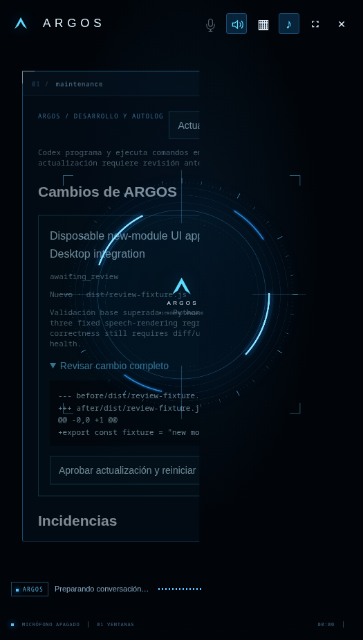

# Self-update recovery: new modules, exact review and rollback

2026-11-08. **The new-file update restriction is corrected and tested. Agent Desktop itself is still not integrated.** [Sanitized evidence](self-update-new-modules-2026-11-08.json).

## Actual request and failure

The user's latest attachment repeats the home-integration brief. The live maintenance journal identifies the matching Agent Desktop request as proposal `ddff1da05a0870316d258461`.

Codex successfully connected, edited source, created `dist/agent-desktop.js`, added tests and returned a public summary. The release validator then raised `PermissionError: New application files require extending the trusted editable scope; not silently installed`. The controller copied only twelve existing mutable application files, rejected every new application source path, and did not give the coder the host/Broker/preload sources. This was a controller scope limit, not evidence that Codex was disconnected or unable to program.

The existing candidate is also incomplete independently of that validation failure. Its summary explicitly says it could not add an MCP process launcher/host registration. Its frontend calls an `agent-desktop` capability that neither the Electron bridge nor the Broker/MCP tool registry exposes. Its mocked frontend tests do not establish a working desktop integration. The failed proposal remains untouched and was not replayed or installed.

## Changes delivered

- Allow new **flat application modules** under `dist/` (`.js`, `.css`) and `runtime/` (`.py`) with bounded names and contents. Existing protected paths cannot be adopted as new files. Nested paths, privileged `.cjs` host entries, source deletion, symlinks, hardlinks and special files remain rejected.
- Serve approved new renderer modules through the existing presentation server, using the release journal rather than opening arbitrary source paths. Candidate, unapproved and rolled-back modules return 404.
- Include created files in the controller-generated diff, source snapshot and exact review digest. Label new files explicitly in the review UI. The model cannot approve or install its own proposal.
- Recheck destinations before approval and installation; a user-created destination blocks overwrite. New modules become part of subsequent proposal baselines through the existing release journal, without another task/memory/source-ownership database.
- Bind the reviewed diff to the validated snapshot and reject changes during validation or installation. Existing/new-file rollback preserves later edits, and failed/interrupted health removes newly created modules.
- Copy selected public host architecture source into a separate **read-only `/context` mount**: Broker, app launcher adapter, machine path definitions, MCP schemas, Electron main/preload and presentation server. No credentials, user projects, live write mount or release controller is provided. Native command policy grants only read access to this context.
- Tell the coding worker that new application modules are reviewable, the copy need not be a Git repository, and a frontend stub must not be called a working integration when a protected host adapter is missing.
- A successful native diagnostic that produces no source change now has the explicit `no_change` outcome. It retains the explanation without generating another synthetic “Codex produced no source change” development incident. Genuine coding/validation failures remain failures.
- Explain the historical new-file denial as a previous scope limit when viewing that exact old incident; preserve its stored trace and failed proposal. Ordinary authorization denials retain their existing classification.

This does not grant host shell, network, credentials, desktop control, or permission to edit Broker/preload/controller policy to the coder. The update path still requires exact user review, followed by restart health and rollback. It is application-code self-development within the declared scope, not an unrestricted bootstrap for new privileged host capabilities.

## Validation

- **30 new-file checks**: creation diff, approval binding, install, subsequent baselines, stale destinations, rollback, newer edits, rejected protected targets, symlinks/hardlinks/special files, Python syntax, mutation during validation and read-only architecture.
- **26 existing containment/transaction checks** and **8 automatic-diagnosis checks**, passing.
- **361 repository tests**, passing.
- A **real native Codex preparation** created `runtime/agent_desktop_readiness.py` and four tests in a private test proposal. Controller validation reached `awaiting_review`; an independent read-only sandbox reran all four tests successfully. The exact diff identified the created file. The fixture was explicitly rejected without installation and its derived credential copy was removed. It is a pure helper used to validate the updater, **not an Agent Desktop implementation**.
- A **real Electron review interaction** displayed a disposable new-module diff and its `Nuevo` label. Clicking the exact approval queued a restart without hot-writing. The fixture controller installed the approved file, then simulated interrupted startup health and removed it through rollback. HTTP checks also verified that the approved module loads and that unapproved, traversal and rolled-back paths return 404. No live release, microphone, speaker, model or desktop action was used by this UI fixture.
- A second **real native Codex diagnostic** read the host context and returned `no_change`, correctly identifying the missing host registration instead of producing another frontend stub. No files or permissions were changed by that diagnostic and its derived credential was removed.

## Exact remaining Agent Desktop boundary

A working Agent Desktop capability needs an actual bounded adapter and registration in the trusted Broker/MCP dispatch path, plus any necessary Electron IPC/preload allowlisting. The candidate's missing hook cannot be repaired by adding a renderer file or assuming the MCP process exists. Those host sources remain read-only to the self-update coder.

The native diagnostic names `ui-workbench/runtime/workspace_broker.py`, `checks/workspace_mcp.py`, `ui-workbench/desktop/main.cjs` and `ui-workbench/desktop/preload.cjs` as integration points. A separate trusted host integration must implement and verify the bounded capability before advertising it. Existing Hyprland/AT-SPI limitations and the main integration's remaining acceptance gates still apply. No arbitrary desktop authority, unsigned extension reload, model change, paid billing, system package or global executable was enabled here.

The updater infrastructure correction is installed in the isolated ARGOS app; the original Agent Desktop proposal remains failed and uninstalled. Do not interpret the successful new-module tests or the diagnostic `no_change` result as completion of desktop control.

## Installed activation

The normal ARGOS launcher was restarted after installing the infrastructure correction. Its health endpoint reported presentation, Codex conversation, voice and renderer ready; hands-free listening was enabled. The live development capability advertises the three new-module patterns and ten read-only context files. No update was pending, and the original Agent Desktop proposal remained failed. This is startup readiness evidence, not a new microphone-to-speaker or feature latency benchmark.
